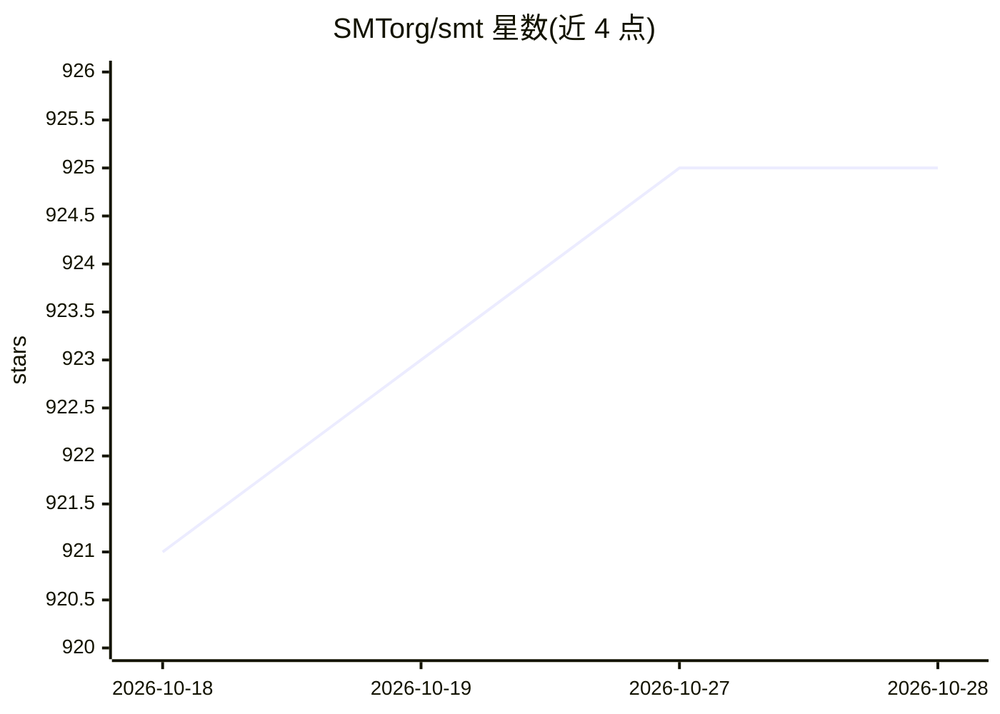

# SMTorg/smt

⭐ 925 · Jupyter Notebook · BSD-3-Clause · 推送 2026-10-27 · [GitHub](https://github.com/SMTorg/smt) · [官网](https://smt.readthedocs.io/en/stable) · 组织维护

**Python 代理建模工具箱：含代理模型、采样与基准测试**

SMT 是一个 Python 代理建模工具箱，收录多种代理建模方法（如基于偏最小二乘的 Kriging、能量最小化样条插值）、采样技术与基准测试函数，面向需要用代理模型近似昂贵仿真的工程设计与科研用户。特点是对导数的支持：训练导数（梯度增强建模）、预测导数以及相对训练数据的导数。依赖 numpy、scipy、scikit-learn、pydoe 与 Cython，通过 pip 安装，文档含教程 notebook 与示例。以 New BSD 许可证分发，附多篇论文引用信息。

## 筛选速览

| 维度 | 判定 | 备注 |
|---|---|---|
| AI 角色 | `ai-native` | 本体是模型或模型工具 |
| 许可风险 | `permissive` | BSD-3-Clause |
| 部署形态 | `library` | 以包/库形式分发 |
| 模型依赖 | — | README 未给出锁定关系 |
| 硬件要求 | — | 无带数字的原话,不猜 |
| 安装摩擦 | `low` | 无编译、无系统依赖或容器化 |
| 成熟度 | — | 结构信号不足 |

## 能力要点

- 多种代理模型、采样技术与基准测试函数的集合库
- 支持训练导数（梯度增强建模）、预测导数与相对训练数据的导数
- 含独家方法：偏最小二乘 Kriging、能量最小化样条插值
- 自动测试代码与动态生成图表嵌入的文档工具

## 适用场景

- 工程设计中用代理模型近似昂贵的仿真计算
- 做梯度增强建模与多保真度建模研究
- 用基准测试函数比较不同代理模型方法

## 场景标签

`科研工具` · 领域:学习与行业

## 证据(README 行号)

> L10: The surrogate modeling toolbox (SMT) is a Python package that contains a collection of surrogate modeling methods, 
> L12: SMT is different from existing surrogate modeling libraries because of its emphasis on derivatives, including train

## 星数曲线

2026-10-18 921 → 2026-10-28 925（+4）

---
*卡片 v1 · prompt 1.4 · 生成 2026-10-21 · 置信度 high · 依据 README sha `e68c633a3323` · [字段定义](../../DATASET.md)*
