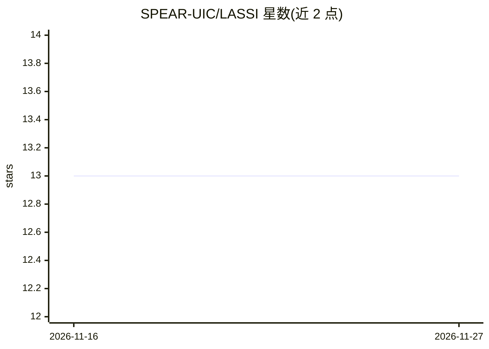

# SPEAR-UIC/LASSI

⭐ 13 · Python · Apache-2.0 · 推送 2026-11-21 · [GitHub](https://github.com/SPEAR-UIC/LASSI) · 组织维护

**面向 HPC 研究者的 LLM 驱动 CUDA/OpenMP 并行代码互译自校正流水线**

LASSI 用大语言模型在 CUDA 与 OpenMP GPU offload 两种编程模型之间翻译科学计算代码，并将编译、运行环节纳入闭环：翻译结果被编译执行，编译器或运行时错误回传给 LLM 修正，直至代码可运行。默认配置复现论文实验，覆盖 HeCBench 基准套件中的 10 个应用。提供 notebook 与命令行两种前端，支持 Ollama、LM Studio 本地模型及任意 OpenAI 兼容 API 后端；CUDA 方向翻译与运行需要 NVIDIA GPU 与对应编译器，纯 CPU 模式仅支持朝 OpenMP 方向。

## 筛选速览

| 维度 | 判定 | 备注 |
|---|---|---|
| AI 角色 | `ai-native` | 本体是模型或模型工具 |
| 许可风险 | `permissive` | Apache-2.0 |
| 部署形态 | `library` | 以包/库形式分发 |
| 模型依赖 | local-ok | 支持本地模型 |
| 硬件要求 | `cpu-ok` | |
| 安装摩擦 | `high` | 编译与系统依赖俱全 |
| 成熟度 | — | 结构信号不足 |

## 能力要点

- 编译+运行双重自校正循环，错误自动回传 LLM 修复
- 支持 Ollama、LM Studio、OpenAI 兼容 API、Argo 四种 LLM 后端
- 内置 HeCBench 基准 10 个应用的 CUDA/OpenMP 源码与运行参数
- 可选 LLM judge 功能等价判定、重复计时、pass@k 多次试验等扩展

## 适用场景

- 将现有 CUDA 科学计算代码迁移到 OpenMP GPU offload
- 评估不同 LLM 在并行代码翻译任务上的成功率
- 复现论文中 A100 上的翻译实验结果

## 场景标签

`代码生成` `模型评测` · 领域:编码与开发

## 证据(README 行号)

> L7: LASSI translates parallel scientific GPU code between programming models with a large language model (LLM), and chec
> L9: LASSI works with open models served locally (Ollama, LM Studio) and with hosted models through any OpenAI-compatible
> L114: |`openai_compatible`|Anyone: OpenAI, vLLM, llama.cpp server, OpenRouter, an institutional gateway, ...|`openai_com

## 星数曲线

2026-11-16 13 → 2026-11-27 13（+0）

---
*卡片 v1 · prompt 1.4 · 生成 2026-11-18 · 置信度 high · 依据 README sha `157d00de2624` · [字段定义](../../DATASET.md)*
