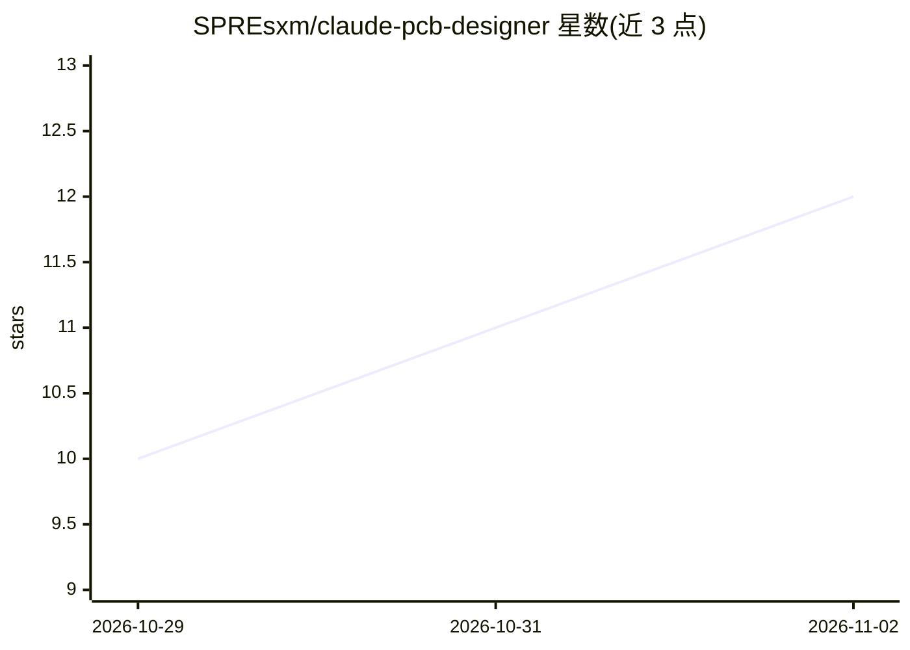

# SPREsxm/claude-pcb-designer

⭐ 12 · Python · MIT · 推送 2026-09-13 · [GitHub](https://github.com/SPREsxm/claude-pcb-designer) · 个人维护 · 中文 README

**让 AI 编程代理执行 PCB 设计、评审与投板发布的 Agent Skill**

开源 Agent Skill（SKILL.md 格式），面向 Codex、Claude Code 等支持 Agent Skills 格式的代理，覆盖从需求、器件选型、原理图评审、叠层/布局/布线、电源与信号完整性、热设计、DFM 到 Gerber 投板审计与板级 bring-up 的完整硬件流程。内置确定性计算器脚本（线宽、过孔电流、阻抗、LDO 热裕量等，支持 --json 输出）、Gerber/BOM/CPL 发布审计器与技能校验器，CI 在三平台运行。支持 KiCad 与 EasyEDA/嘉立创EDA 工作流，可配对 EasyEDA API 技能。明确声明不替代合格工程师评审、datasheet、EMC 认证等。

## 筛选速览

| 维度 | 判定 | 备注 |
|---|---|---|
| AI 角色 | `ai-ecosystem` | LLM/agent 周边工具 |
| 许可风险 | `permissive` | MIT |
| 部署形态 | `None` |  |
| 模型依赖 | — | README 未给出锁定关系 |
| 硬件要求 | — | 无带数字的原话,不猜 |
| 安装摩擦 | `low` | 无编译、无系统依赖或容器化 |
| 成熟度 | — | 结构信号不足 |

## 能力要点

- 11 个确定性计算器命令，JSON 输出供代理间协作
- Gerber/drill/BOM/CPL 发布审计器（无依赖脚本）
- 五道流程门（需求→原理图→布局→投板→bring-up）
- 危险领域（市电、锂电池、医疗、汽车等）强制人工评审边界

## 适用场景

- 让 Claude Code/Codex 代理设计 ESP32 传感器板等原型板
- 投板前审计 Gerber/BOM/CPL 发布包，发给 JLCPCB 前检查
- 评审现有 KiCad 布局的制造阻塞与热风险
- 计算 LDO 热裕量、线宽、阻抗等确定性参数

## 场景标签

 · 领域:电子工程/EDA

## 证据(README 行号)

> L3: **An open Agent Skill that turns AI coding agents into disciplined PCB design,
> L20: It works with Codex, Claude Code, and other tools that understand the

## 星数曲线

2026-10-29 10 → 2026-11-02 12（+2）

---
*卡片 v1 · prompt 1.4 · 生成 2026-11-02 · 置信度 high · 依据 README sha `1c1eda9a1b62` · [字段定义](../../DATASET.md)*
