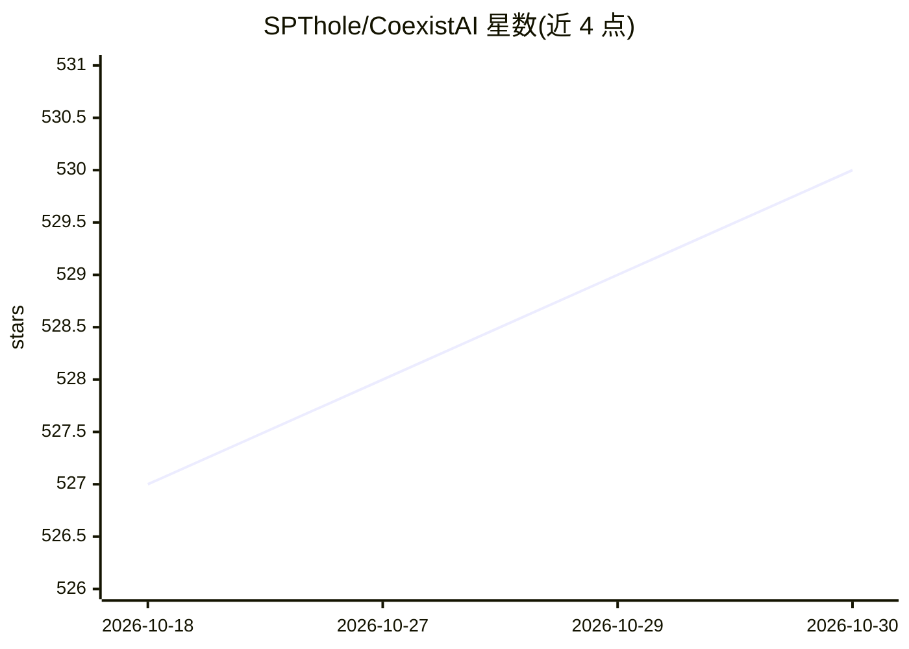

# SPThole/CoexistAI

⭐ 530 · Jupyter Notebook · NOASSERTION · 推送 2026-03-10 · [GitHub](https://github.com/SPThole/CoexistAI) · 个人维护

**面向开发者的研究助手框架：LLM 驱动的多源搜索与自动化**

模块化的研究助手框架，以 FastAPI、MCP 服务器和 Python 库三种方式提供工具：网页搜索/摘要、Reddit 检索（BM25 排序）、YouTube 视频搜索与问答、地图与路线查询、GitHub/本地代码库问答，以及文本转播客/TTS。LLM 与嵌入器可插拔，支持 Gemini、OpenAI、Ollama 及 LangChain 兼容模型。安装依赖 Docker（运行 SearxNG 容器），许可为非商业研究教育用途，禁止生产使用；Reddit 数据走公开 JSON 端点而非官方 API。

## 筛选速览

| 维度 | 判定 | 备注 |
|---|---|---|
| AI 角色 | `ai-ecosystem` | LLM/agent 周边工具 |
| 许可风险 | `none` | NOASSERTION |
| 部署形态 | `None` |  |
| 模型依赖 | local-ok | 支持本地模型 |
| 硬件要求 | — | 无带数字的原话,不猜 |
| 安装摩擦 | `low` | 无编译、无系统依赖或容器化 |
| 成熟度 | — | 结构信号不足 |

## 能力要点

- Web/Reddit/YouTube/地图/GitHub 多源研究工具，经 FastAPI 或 MCP 调用
- LLM 与嵌入器可插拔（Gemini/OpenAI/Ollama/LangChain 兼容模型）
- 文本转播客与 TTS 音频生成
- 本地模式下可全程本地运行（含 LM Studio 的 MCP 集成）

## 适用场景

- 为 agent 或 MCP 客户端接入多源研究与检索工具
- 对网页、论文、YouTube 视频或代码库做摘要与问答
- 搭建非商业用途的自动化研究工作流

## 场景标签

`Agent 框架` `网页抓取` `语音合成` · 领域:Agent 开发

## 证据(README 行号)

> L3: CoexistAI is a modular, developer-friendly research assistant framework. It enables you to build, search, summarize,
> L27: - **Pluggable LLMs and Embedders**: Use any LLMs Google Gemini, OpenAI, Ollama, and any embedders
> L29: - **Notebook & API Ready**: Use as a Python library or via a FAST API.

## 星数曲线

2026-10-18 527 → 2026-10-30 530（+3）

---
*卡片 v1 · prompt 1.4 · 生成 2026-10-21 · 置信度 high · 依据 README sha `79a5c5d5c4cf` · [字段定义](../../DATASET.md)*
