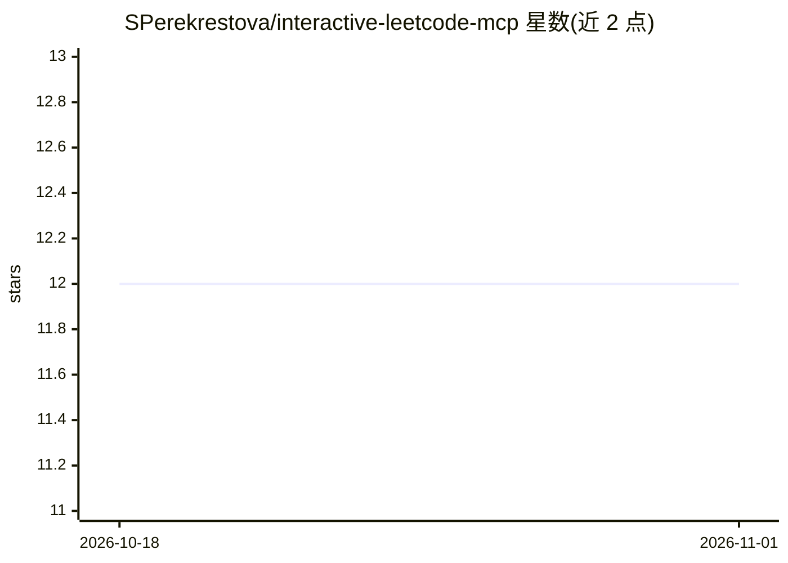

# SPerekrestova/interactive-leetcode-mcp

⭐ 12 · TypeScript · MIT · 推送 2026-09-15 · [GitHub](https://github.com/SPerekrestova/interactive-leetcode-mcp) · [官网](https://www.npmjs.com/package/@sperekrestova/interactive-leetcode-mcp) · 个人维护

**让 AI 在 leetcode.com 上引导刷题的 MCP 服务器**

一个 MCP 服务器，供 Claude 等 AI agent 接入 LeetCode：提供登录认证流程、题目获取与搜索、代码提交与结果反馈、用户资料与竞赛排名查询等约 20 个工具。核心是引导式学习模式：通过 4 级渐进提示让 AI 先给提示、再在达到条件后解锁题解；另支持本地子进程沙箱运行样例测试。需要 Node.js v20+、LeetCode 账号与浏览器，凭据以 cookie 形式保存、7-14 天过期。README 自述项目仍在积极开发中。

## 筛选速览

| 维度 | 判定 | 备注 |
|---|---|---|
| AI 角色 | `ai-ecosystem` | LLM/agent 周边工具 |
| 许可风险 | `permissive` | MIT |
| 部署形态 | `library` | 以包/库形式分发 |
| 模型依赖 | locked-api |  |
| 硬件要求 | — | 无带数字的原话,不猜 |
| 安装摩擦 | `low` | 无编译、无系统依赖或容器化 |
| 成熟度 | `idea` | |

## 能力要点

- 约 20 个 MCP 工具：认证、题目获取、提交、用户数据查询
- 4 级渐进提示的学习模式，达到最终提示级才解锁题解工具
- 本地沙箱运行样例测试（runner_doctor / run_local_tests）
- 附带 agent 技能与 Claude Code 插件，可发布到 ClawHub

## 适用场景

- 让 Claude 引导我做 LeetCode 题目，先给提示再看题解
- 在 Claude Code 中提交代码并查看运行时/内存等反馈
- 查询自己的提交记录与竞赛排名

## 场景标签

 · 领域:教育/编程练习工具

## 证据(README 行号)

> L15: - 🔐 **AI-guided authentication** - Claude walks you through one-time credential setup
> L16: - 🎓 **Learning-guided mode** - AI provides hints before solutions to maximize learning
> L379: This repo also ships an **agent skill** that teaches Claude (and other AI agents) how to use the MCP server correc

## 星数曲线

2026-10-18 12 → 2026-11-01 12（+0）

---
*卡片 v1 · prompt 1.4 · 生成 2026-11-01 · 置信度 high · 依据 README sha `a7f20701b9b7` · [字段定义](../../DATASET.md)*
