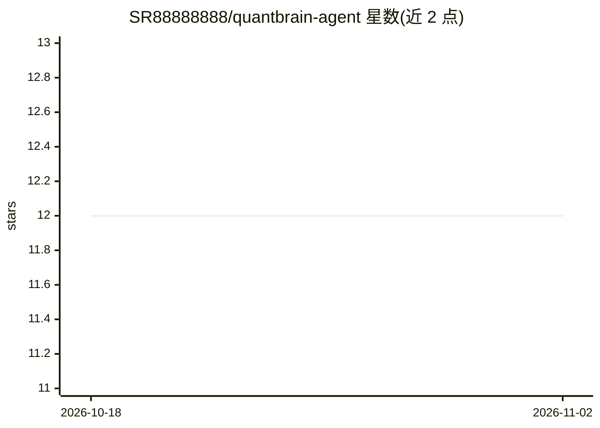

# SR88888888/quantbrain-agent

⭐ 12 · Python · MIT · 推送 2026-03-02 · [GitHub](https://github.com/SR88888888/quantbrain-agent) · 个人维护 · 中文 README

**A股AI产业链投研的多智能体自动化研报生成系统**

以 Qwen2.5-72B-AWQ 为推理内核、LangGraph 编排六路智能体协作流的全链路 A 股投研系统：东方财富与新浪财经双源采集行情舆情，结合产业链知识图谱（SQLite 存储、10 只核心标的×6 类关系）推演，经 CoT+ReAct+Reflexion 架构产出研报，APScheduler 工作日 9:00 定时触发并经飞书 Webhook 推送。基于 2000 条自蒸馏语料做 LoRA 微调（r=8），20 题盲测净胜率 65%。需 Python 3.10+ 与已部署 vLLM 的 CUDA GPU 环境，Docker 部署可用。

## 筛选速览

| 维度 | 判定 | 备注 |
|---|---|---|
| AI 角色 | `ai-native` | 本体是模型或模型工具 |
| 许可风险 | `permissive` | MIT |
| 部署形态 | `self-host` | docker 或自建部署 |
| 模型依赖 | local-ok | 支持本地模型 |
| 硬件要求 | — | 无带数字的原话,不猜 |
| 安装摩擦 | `low` | 无编译、无系统依赖或容器化 |
| 成熟度 | — | 结构信号不足 |

## 能力要点

- LangGraph 编排 1+3+1+1 多智能体架构（采集/三路并行分析/Supervisor/编撰审核）
- LoRA on AWQ 微调，vLLM 动态加载，零侵入切换基础/微调模型
- MCP 协议封装 9 项原子工具（行情/资金流/知识图谱/记忆）
- APScheduler 定时触发研报并推送飞书 Webhook

## 适用场景

- 每日定时获取 A 股 AI 产业链的自动化研报
- 复现 Qwen2.5-72B-AWQ 的金融领域 LoRA 微调流程
- 基于产业链知识图谱做板块与上下游联动推演

## 场景标签

`金融量化` `多智能体` `知识图谱` `微调` · 领域:Agent 开发

## 证据(README 行号)

> L12: 稷下智脑是一套面向 A 股 AI 产业链投研场景的**全链路自动化系统**。针对传统投研时效差、逻辑碎片化、数据难量化等核心痛点，系统以 Qwen2.5-72B-AWQ 为推理内核，通过 LangGraph 编排六路智能体协作流，
> L30: - 基于 Qwen2.5-72B-AWQ 使用 autoawq 原生加载，通过 PEFT 挂载 LoRA 适配器（r=8，target: q_proj/v_proj）

## 星数曲线

2026-10-18 12 → 2026-11-02 12（+0）

---
*卡片 v1 · prompt 1.4 · 生成 2026-11-01 · 置信度 high · 依据 README sha `3f03ab6407ae` · [字段定义](../../DATASET.md)*
