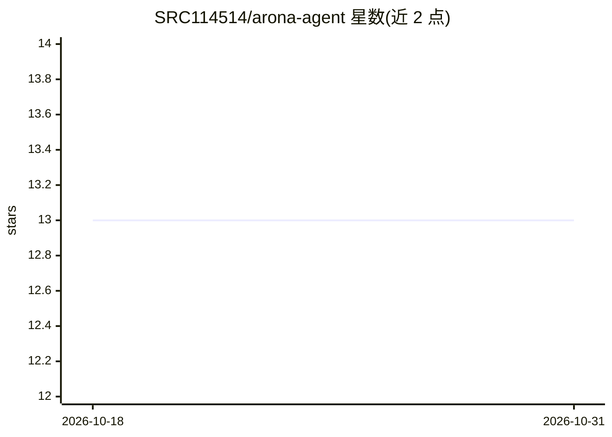

# SRC114514/arona-agent

⭐ 13 · TypeScript · MIT · 推送 2026-09-08 · [GitHub](https://github.com/SRC114514/arona-agent) · 个人维护 · 中文 README

**带蔚蓝档案桌宠的终端 AI Agent，支持语音与 Computer Use**

基于 Pi SDK 构建的终端对话式 AI Agent，以《蔚蓝档案》角色阿洛娜为桌宠形象（透明置顶 Electron 窗口、瞳孔跟随鼠标、摸头彩蛋）。功能含 Computer Use（基于 cua）、非流式 TTS/STT（默认走阿里云百炼 qwen-audio 模型，可选 gpt-sovits）、多角色群聊（主/子 Agent 依次接话）、持久记忆、自定义 Skill 与 MCP 服务器扩展。要求 Node.js >= 22.19.0 与 Python 3.12/3.13，配置集中于 ~/.arona/。注意：assets/blue-archive/ 素材未随项目授予许可，需用户自行获取。

## 筛选速览

| 维度 | 判定 | 备注 |
|---|---|---|
| AI 角色 | `ai-native` | 本体是模型或模型工具 |
| 许可风险 | `permissive` | MIT |
| 部署形态 | `library` | 以包/库形式分发 |
| 模型依赖 | — | README 未给出锁定关系 |
| 硬件要求 | — | 无带数字的原话,不猜 |
| 安装摩擦 | `low` | 无编译、无系统依赖或容器化 |
| 成熟度 | — | 结构信号不足 |

## 能力要点

- Computer Use 与 MCP 服务器工具自动注册
- TTS/STT 支持 aliyun 与 gpt-sovits 两种后端
- 多角色群聊：主 Agent 回复后子 Agent 依次接话
- 自定义 Skill（SKILL.md）与持久记忆（MEMORY.md）

## 适用场景

- 在终端与桌面桌宠形态的 AI 角色对话
- 让 Agent 执行 Computer Use 操作电脑
- 通过热键长按触发语音输入与语音合成

## 场景标签

`GUI 自动化` `语音合成` `AI 助手` · 领域:效率与自动化

## 证据(README 行号)

> L11: 基于 Pi SDK 构建的终端对话式 AI Agent，集成 Computer Use、TTS / STT、桌面宠物与持久记忆。
> L33: - **Computer Use**：基于 cua 。
> L34: - **语音**：非流式 TTS + STT。

## 星数曲线

2026-10-18 13 → 2026-10-31 13（+0）

---
*卡片 v1 · prompt 1.4 · 生成 2026-10-31 · 置信度 high · 依据 README sha `eafffe644135` · [字段定义](../../DATASET.md)*
