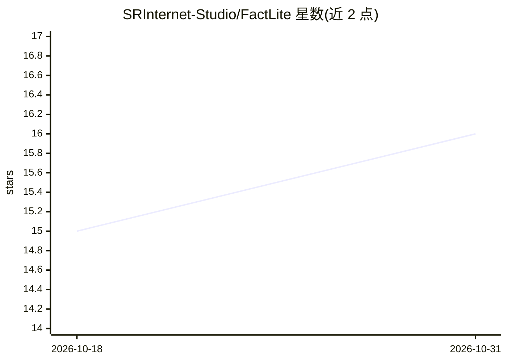

# SRInternet-Studio/FactLite

⭐ 16 · Python · MIT · 推送 2026-08-23 · [GitHub](https://github.com/SRInternet-Studio/FactLite) · 组织维护 · 中文 README

**给 LLM 调用加事实核查装饰器的 Python 微框架**

面向开发者的轻量级 Python 微框架，通过单个 @verify 装饰器为既有 LLM 调用函数添加“生成→评估→反思重试”的自纠错循环。内置 Regex/Length/JSON 校验器、LLMJudge、调用 OpenAI Moderation API 的内容审查，以及基于 Web 搜索（DuckDuckGo/Bing/Google 后端）核验时效性信息的 Web_LLMJudge；支持规则链式执行、自定义校验逻辑（CustomJudge）与失败策略（FallbackAction）。原生 async 且评测在独立线程运行。README 附 AA-Omniscience 基准测试（DeepSeek 模型、201 题）与 McNemar 检验结果。需 Python 3.10+，与具体 LLM 调用方式无关。

## 筛选速览

| 维度 | 判定 | 备注 |
|---|---|---|
| AI 角色 | `ai-ecosystem` | LLM/agent 周边工具 |
| 许可风险 | `permissive` | MIT |
| 部署形态 | `library` | 以包/库形式分发 |
| 模型依赖 | — | README 未给出锁定关系 |
| 硬件要求 | — | 无带数字的原话,不猜 |
| 安装摩擦 | `low` | 无编译、无系统依赖或容器化 |
| 成熟度 | — | 结构信号不足 |

## 能力要点

- 单个 @verify 装饰器零侵入接入既有 LLM 调用
- Generate→Evaluate→Reflect 自纠错循环，达 max_retries 后执行 FallbackAction
- 内置正则/长度/JSON 校验、ModerationJudge、Web 搜索核验的 Web_LLMJudge
- 规则链式执行与 CustomJudge 自定义校验

## 适用场景

- 给生产环境的 LLM 调用加幻觉拦截与自动重试
- 对时效性问题的回答做 Web 搜索交叉核验
- 按企业策略（禁词、JSON schema、长度）约束模型输出

## 场景标签

 · 领域:LLM 基础设施/可靠性

## 证据(README 行号)

> L15: **FactLite** is a production-ready, feather-light Python micro-framework designed to solve this exact problem. It e
> L25: * **🌐 Framework Agnostic:** FactLite doesn't care how you call your LLM. Whether you're using the `openai` SDK, `an
> L248: FactLite's `@verify` decorator wraps your function in a simple yet powerful control loop:

## 星数曲线

2026-10-18 15 → 2026-10-31 16（+1）

---
*卡片 v1 · prompt 1.4 · 生成 2026-10-30 · 置信度 high · 依据 README sha `529cc5467edb` · [字段定义](../../DATASET.md)*
