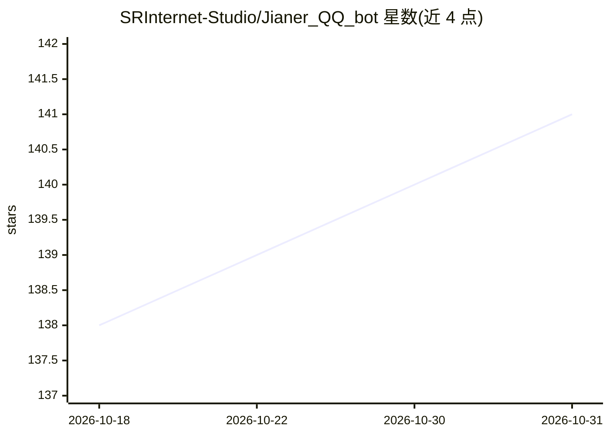

# SRInternet-Studio/Jianer_QQ_bot

⭐ 141 · Python · GPL-3.0 · 推送 2026-10-24 · [GitHub](https://github.com/SRInternet-Studio/Jianer_QQ_bot) · 组织维护 · 中文 README

**基于 OneBot v11 的 QQ 群机器人：多模型 AI 对话与群管娱乐**

基于 OneBot v11 协议的新一代 QQ 群机器人，功能分四块：AI（Deepseek、Google Gemini、ChatGPT 多模型对话、EdgeTTS 语音回复、按用户存储的预设与上下文管理、群聊角色扮演）；娱乐（ACG/Pixiv 生图、一言、B站抖音快手解析等插件）；群管（撤回、禁言、踢人、三级管理、入群欢迎、定时群发、加群自动审批）；以及 runcommand、聊天记录总结等原生插件。支持插件市场，部署需自行完成配置，官方另有托管机器人账号可供申请使用。

## 筛选速览

| 维度 | 判定 | 备注 |
|---|---|---|
| AI 角色 | `ai-native` | 本体是模型或模型工具 |
| 许可风险 | `viral` | GPL-3.0 |
| 部署形态 | `None` |  |
| 模型依赖 | locked-api |  |
| 硬件要求 | — | 无带数字的原话,不猜 |
| 安装摩擦 | `low` | 无编译、无系统依赖或容器化 |
| 成熟度 | — | 结构信号不足 |

## 能力要点

- 多模型 AI 对话（Deepseek/Gemini/ChatGPT）与 EdgeTTS 语音回复
- 按单个用户分别存储的预设与上下文管理器
- 三级管理机制与入群欢迎、定时群发、加群自动审批等群管功能
- 插件市场与原生/社区插件体系（ACG 生图、视频解析、聊天记录总结等）

## 适用场景

- QQ 群里 @机器人 进行多模型 AI 对话与角色扮演
- 自动执行禁言、踢人、入群审批等群管理操作
- 通过插件扩展生图、视频解析、签到等娱乐功能

## 场景标签

`聊天机器人` · 领域:对话与助手

## 证据(README 行号)

> L11: 开源 · 模块化 · 易于配置 —— 基于 OneBot v11 的新一代 QQ 群机器人
> L12: 多模型AI对话、插件市场、入群欢迎、图片生成、禁言或踢人等娱乐和群管助手
> L33: - [x] Deepseek

## 星数曲线

2026-10-18 138 → 2026-10-31 141（+3）

---
*卡片 v1 · prompt 1.4 · 生成 2026-10-22 · 置信度 high · 依据 README sha `2240f0ce2178` · [字段定义](../../DATASET.md)*
