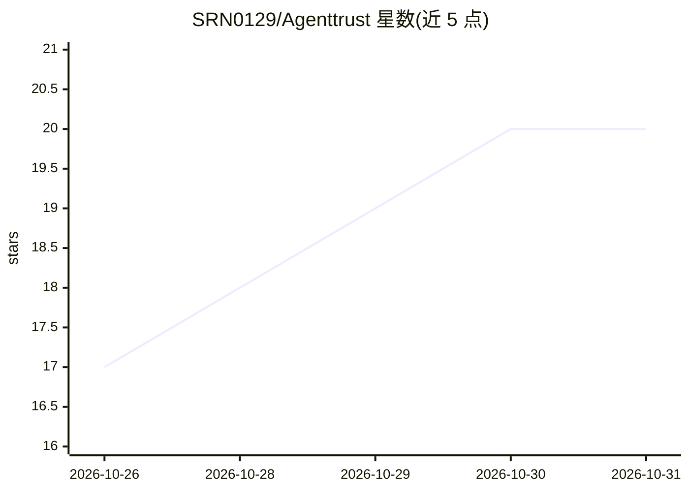

# SRN0129/Agenttrust

⭐ 20 · TypeScript · NOASSERTION · 推送 2026-10-30 · [GitHub](https://github.com/SRN0129/Agenttrust) · 个人维护

**给企业开发者的 AI agent 零信任安全网关与审计基础设施**

位于 LLM agent 运行时与外部工具执行环境之间的控制平面：拦截每个拟执行动作，检测提示注入与数据泄露，执行细粒度能力策略（如 database:orders:SELECT 级别的动词范围控制），对高危动作要求人工批准（EU AI Act Art. 14），并将事件记录到由 SHA-256 哈希链、Merkle 收据与 NIST FIPS 204 后量子签名保护的审计账本。支持 LangChain/CrewAI/AutoGen 等框架接入，提供 Python/TypeScript/Go/Rust SDK 与 React 仪表盘，另含 LEO 卫星公证、直连卫星紧急冻结等四个独立 npm 防御包（此类卫星机制为 README 声明，真实性未验证）。

## 筛选速览

| 维度 | 判定 | 备注 |
|---|---|---|
| AI 角色 | `ai-ecosystem` | LLM/agent 周边工具 |
| 许可风险 | `none` | NOASSERTION |
| 部署形态 | `library` | 以包/库形式分发 |
| 模型依赖 | — | README 未给出锁定关系 |
| 硬件要求 | — | 无带数字的原话,不猜 |
| 安装摩擦 | `low` | 无编译、无系统依赖或容器化 |
| 成熟度 | — | 结构信号不足 |

## 能力要点

- deny-by-default 能力匹配与 SQL/REST/云 API 的动词级范围控制（CWE-863）
- CoT 哈希锚定审计与越狱/认知偏离拦截
- 审批后运行时看门狗：拦截 SSRF/IMDS 元数据窃取并自动隔离
- SHA-256 哈希链 + NIST FIPS 204 后量子签名的不可篡改审计账本

## 适用场景

- 企业为接入 bash/SQL/云凭据的自主 agent 设置确定性策略边界
- 对高危 agent 动作实施一键人工审批与预算上限
- 满足 EU AI Act 等合规要求的可验证审计留痕

## 场景标签

`网络安全` · 领域:学习与行业

## 证据(README 行号)

> L22: > **The Solution**: **AgentTrust** sits between autonomous LLM agent runtimes and external tool execution environme
> L26: AgentTrust is architected as an **open, modular monorepo**. You do not have to deploy the full enterprise control p

## 星数曲线

2026-10-26 17 → 2026-10-31 20（+3）

---
*卡片 v1 · prompt 1.4 · 生成 2026-10-28 · 置信度 mid · 依据 README sha `59c8a412e093` · [字段定义](../../DATASET.md)*
