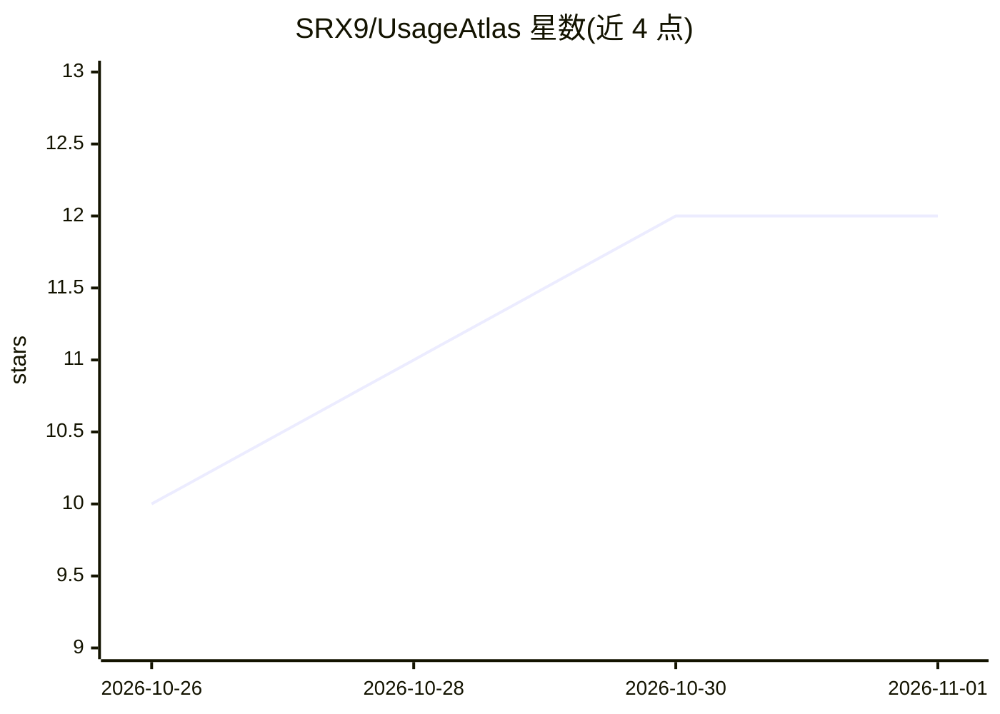

# SRX9/UsageAtlas

⭐ 12 · TypeScript · MIT · 推送 2026-10-26 · [GitHub](https://github.com/SRX9/UsageAtlas) · [官网](https://usageatlas.com/) · 个人维护

**跨 14 种 AI 编码工具的用量与额度桌面监控面板**

Electron 桌面应用，读取本地文件与各工具已有登录态，聚合 Claude Code、Codex、Cursor、OpenCode 等 14 种 AI 编码工具的 token 用量、订阅额度、余额与成本历史，提供今日容量表、7/30/90 天按项目/会话/模型/工具的洞察视图、限额前原生通知。默认无需账户，本地存储；可选免费账户开启云保存与跨机恢复。Windows/macOS/Linux 提供安装包，也可用 Bun + Node.js 从源码构建。

## 筛选速览

| 维度 | 判定 | 备注 |
|---|---|---|
| AI 角色 | `ai-ecosystem` | LLM/agent 周边工具 |
| 许可风险 | `permissive` | MIT |
| 部署形态 | `desktop` | 安装包/桌面程序 |
| 模型依赖 | — | README 未给出锁定关系 |
| 硬件要求 | — | 无带数字的原话,不猜 |
| 安装摩擦 | `low` | 无编译、无系统依赖或容器化 |
| 成熟度 | — | 结构信号不足 |

## 能力要点

- 读取本地数据与已有登录态，聚合 14 种工具的用量与额度
- 今日视图含容量表、重置时间、积分与逐时活动；7/30/90 天多维度洞察
- 限额前触发原生通知，托盘常驻与开机自启
- 无账户本地运行；可选云保存跨机恢复，凭据存于系统加密存储

## 适用场景

- 在一个面板查看多个 AI 编码工具的剩余额度和用量趋势
- 在撞上限额前收到提醒，安排编码工作
- 换机或重装后恢复历史用量记录

## 场景标签

`LLM 可观测性` · 领域:评测与运维

## 证据(README 行号)

> L5:  One desktop dashboard for your AI coding usage.
> L37: UsageAtlas reads local activity and reuses supported tool sign-ins. Providers that require an API key or session ca

## 星数曲线

2026-10-26 10 → 2026-11-01 12（+2）

---
*卡片 v1 · prompt 1.4 · 生成 2026-11-01 · 置信度 high · 依据 README sha `a2777949c7b6` · [字段定义](../../DATASET.md)*
