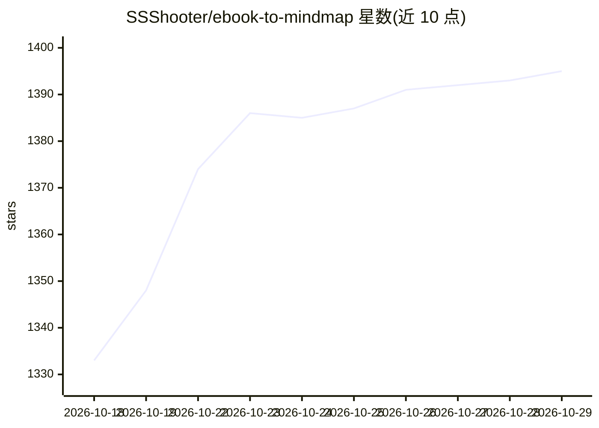

# SSShooter/ebook-to-mindmap

⭐ 1,395 · TypeScript · MIT · 推送 2026-09-07 · [GitHub](https://github.com/SSShooter/ebook-to-mindmap) · [官网](https://app.mind-elixir.com/ebook-to-mindmap) · 个人维护 · 中文 README

**把 EPUB/PDF 电子书转成 AI 总结与思维导图的工具**

面向读书用户的电子书解析工具：解析 EPUB 与 PDF 的章节结构，调用 Google Gemini 或 OpenAI 模型生成章节总结、章节关联分析、全书总结或章节/整书思维导图。支持 BYOK 模式（浏览器本地直连供应商）或登录 Mind Elixir 账号用内置托管模型。提供缓存续传、自定义提示词、章节分组；限制包括 BYOK 网页版可能遇 CORS、整书导图受模型上下文限制。同一代码支持网页版与 Tauri 桌面端。

## 筛选速览

| 维度 | 判定 | 备注 |
|---|---|---|
| AI 角色 | `ai-native` | 本体是模型或模型工具 |
| 许可风险 | `permissive` | MIT |
| 部署形态 | `self-host` | docker 或自建部署 |
| 模型依赖 | — | README 未给出锁定关系 |
| 硬件要求 | — | 无带数字的原话,不猜 |
| 安装摩擦 | `low` | 无编译、无系统依赖或容器化 |
| 成熟度 | — | 结构信号不足 |

## 能力要点

- EPUB/PDF 章节提取与智能章节边界检测
- 三种模式：文字总结/章节思维导图/整书思维导图
- BYOK 模式 AI 请求由浏览器本地直连供应商
- 缓存续传与自定义提示词（可完全覆盖系统提示词）

## 适用场景

- 把厚书快速拆解为结构化思维导图辅助阅读
- 生成章节与全书文字总结梳理内容
- 将导出的思维导图数据导入 Mind Elixir 桌面端二次编辑

## 场景标签

`文档解析` `AI 写作` · 领域:内容生成

## 证据(README 行号)

> L11: 一个基于 AI 技术的智能电子书解析工具，支持将 EPUB 和 PDF 格式的电子书转换为结构化的思维导图和文字总结。
> L37: - **多种 AI 服务**：支持 Google Gemini 和 OpenAI GPT 模型

## 星数曲线

2026-10-18 1,333 → 2026-10-29 1,395（+62）

---
*卡片 v1 · prompt 1.4 · 生成 2026-10-21 · 置信度 high · 依据 README sha `2ddddefac817` · [字段定义](../../DATASET.md)*
