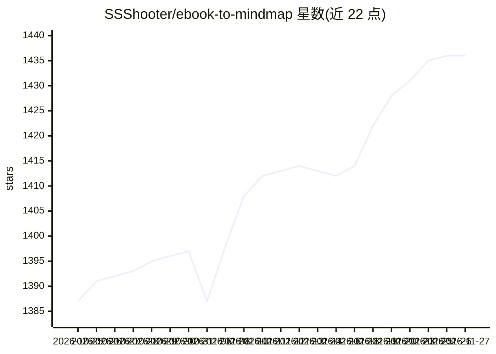

# SSShooter/ebook-to-mindmap

⭐ 1,436 · TypeScript · MIT · 推送 2026-11-10 · [GitHub](https://github.com/SSShooter/ebook-to-mindmap) · [官网](https://app.mind-elixir.com/ebook-to-mindmap) · 个人维护 · 中文 README

**面向读者的电子书 AI 总结工具：EPUB/PDF 转思维导图**

将 EPUB 与 PDF 电子书解析为章节结构后调用 AI 生成三种输出：文字总结（章节总结、章节关联、全书总结）、章节思维导图与整书思维导图。支持 BYOK 模式由浏览器直连 AI 供应商，或登录 Mind Elixir 账号使用托管模型；可自定义提示词、智能检测章节、按章节分组合并处理，AI 结果自动缓存以支持中断续跑与离线查看。网页版与 Tauri 桌面端共用一套代码，导出的思维导图可导入 Mind Elixir 编辑器二次编辑。

## 筛选速览

| 维度 | 判定 | 备注 |
|---|---|---|
| AI 角色 | `ai-native` | 本体是模型或模型工具 |
| 许可风险 | `permissive` | MIT |
| 部署形态 | `self-host` | docker 或自建部署 |
| 模型依赖 | — | README 未给出锁定关系 |
| 硬件要求 | — | 无带数字的原话,不猜 |
| 安装摩擦 | `low` | 无编译、无系统依赖或容器化 |
| 成熟度 | — | 结构信号不足 |

## 能力要点

- EPUB/PDF 解析并生成章节/整书思维导图与文字总结
- BYOK 模式浏览器直连 Google/OpenAI，不经第三方代理
- 自定义提示词可完全覆盖系统默认（文字总结模式）
- AI 结果缓存支持中断续跑与离线查看

## 适用场景

- 把教材或工具书转成结构化思维导图便于复习
- 为小说生成章节总结与全书脉络分析
- 用自有 API Key 批量拆书并导出脑图二次编辑

## 场景标签

`文档解析` `AI 写作` · 领域:内容生成

## 证据(README 行号)

> L11: 一个基于 AI 技术的智能电子书解析工具，支持将 EPUB 和 PDF 格式的电子书转换为结构化的思维导图和文字总结。
> L37: - **多种 AI 服务**：支持 Google Gemini 和 OpenAI GPT 模型
> L42:  - 📝 **文字总结模式**：生成章节总结、分析章节关联、输出全书总结

## 星数曲线

2026-10-25 1,387 → 2026-11-27 1,436（+49）

---
*卡片 v1 · prompt 1.4 · 生成 2026-11-23 · 置信度 high · 依据 README sha `ef4c2f2663bd` · [字段定义](../../DATASET.md)*
