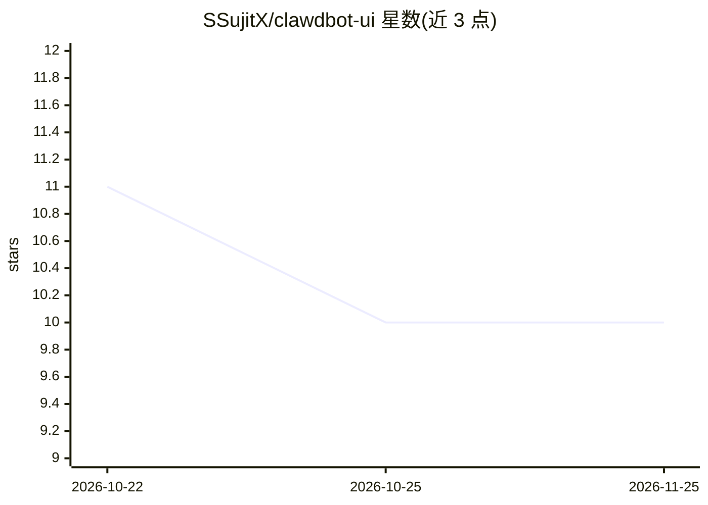

# SSujitX/clawdbot-ui

⭐ 10 · Python · 推送 2026-01-28 · [GitHub](https://github.com/SSujitX/clawdbot-ui) · 个人维护

**ClawdBot AI 网关的桌面管理面板：启停服务与技能管理**

基于 PyQt6 的 Windows/macOS 桌面应用，用于管理 ClawdBot AI 网关：一键启停服务、实时查看网关日志、通过内置 Web UI Token 访问仪表盘；内置 ClawdHub 技能管理器可安装/更新/卸载技能（如 humanizer、self-improving-agent）；管理员终端以提权方式执行命令。需要 Python 3.13+ 且完整功能依赖已安装的 ClawdBot，提供 uv/pip 源码安装与 PyInstaller 打包单文件可执行程序的构建流程。

## 筛选速览

| 维度 | 判定 | 备注 |
|---|---|---|
| AI 角色 | `ai-ecosystem` | LLM/agent 周边工具 |
| 许可风险 | `none` | — |
| 部署形态 | `desktop` | 安装包/桌面程序 |
| 模型依赖 | — | README 未给出锁定关系 |
| 硬件要求 | — | 无带数字的原话,不猜 |
| 安装摩擦 | `low` | 无编译、无系统依赖或容器化 |
| 成熟度 | — | 结构信号不足 |

## 能力要点

- 一键启停 ClawdBot 网关并实时流式查看日志
- ClawdHub 技能安装/更新/卸载全生命周期管理
- 管理员终端支持 Windows UAC 提权执行命令
- 可经 PyInstaller 构建单文件可执行程序

## 适用场景

- 不使用终端管理本地 ClawdBot 网关服务
- 为本机 ClawdBot 安装与管理技能
- 集中查看网关运行状态与实时日志

## 场景标签

 · 领域:AI 基础设施/管理工具

## 证据(README 行号)

> L5: ClawdBot Control Panel is a native desktop application for managing your ClawdBot AI gateway. Built with PyQt6, it w
> L22: - **Start/Stop Service** - One-click gateway management
> L30: - **Install Skills** - Humanizer, self-improving-agent, and more

## 星数曲线

2026-10-22 11 → 2026-11-25 10（-1）

---
*卡片 v1 · prompt 1.4 · 生成 2026-11-20 · 置信度 high · 依据 README sha `9af7736fc9b2` · [字段定义](../../DATASET.md)*
