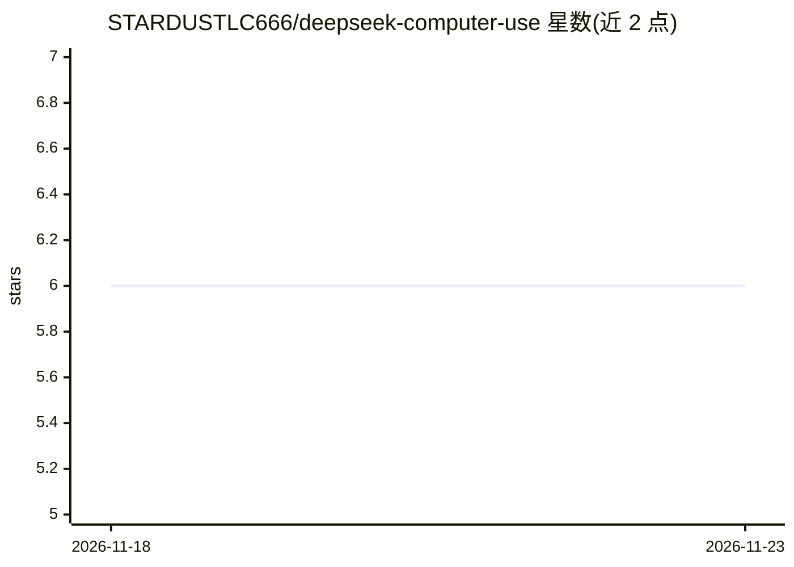

# STARDUSTLC666/deepseek-computer-use

⭐ 6 · JavaScript · MIT · 推送 2026-11-20 · [GitHub](https://github.com/STARDUSTLC666/deepseek-computer-use) · [官网](https://www.npmjs.com/package/deepseek-computer-use) · 个人维护 · 中文 README

**给 DSH 加 Windows 桌面操作能力的插件**

DeepSeek Harness（DSH）的 Windows 桌面操作插件：提供窗口截图、UIA 界面控件树读取、鼠标键盘输入三类工具，配合按会话的应用授权机制限制 agent 可操作范围，并保留操作审计与中断能力；基于 Cordis ctx.effect 实现热重载时桥接进程与光标状态的自动回收。通过 DSH 桌面版插件面板或 dsh CLI 安装，面向 Windows 10/11。

## 筛选速览

| 维度 | 判定 | 备注 |
|---|---|---|
| AI 角色 | `ai-ecosystem` | LLM/agent 周边工具 |
| 许可风险 | `permissive` | MIT |
| 部署形态 | `None` |  |
| 模型依赖 | locked-api |  |
| 硬件要求 | — | 无带数字的原话,不猜 |
| 安装摩擦 | `low` | 无编译、无系统依赖或容器化 |
| 成熟度 | — | 结构信号不足 |

## 能力要点

- 窗口截图与 UIA 控件树读取，供 agent 观察后决策
- 按会话的应用授权，限制可操作的应用范围
- 操作审计与任务中断能力
- 热重载时桥接进程与光标状态自动回收

## 适用场景

- 让 DSH 助手代我在桌面应用中执行点击和输入
- 限定授权范围内自动操作目标软件并留审计记录
- 自动化重复的 Windows 桌面流程

## 场景标签

`GUI 自动化` · 领域:效率与自动化

## 证据(README 行号)

> L7: DeepSeek Harness（`>=0.2.2-rc.3`）Windows 桌面操作插件：支持窗口截图、UIA 界面控件树读取、鼠标键盘输入、按会话应用授权及操作审计，并基于 Cordis `ctx.effect` 实现热重载时
> L34: 1. 在 Windows 10/11 的实际 DSH profile 中安装 deepseek-computer-use，然后创建新会话。

## 星数曲线

2026-11-18 6 → 2026-11-23 6（+0）

---
*卡片 v1 · prompt 1.4 · 生成 2026-11-20 · 置信度 high · 依据 README sha `d3507bbea49b` · [字段定义](../../DATASET.md)*
