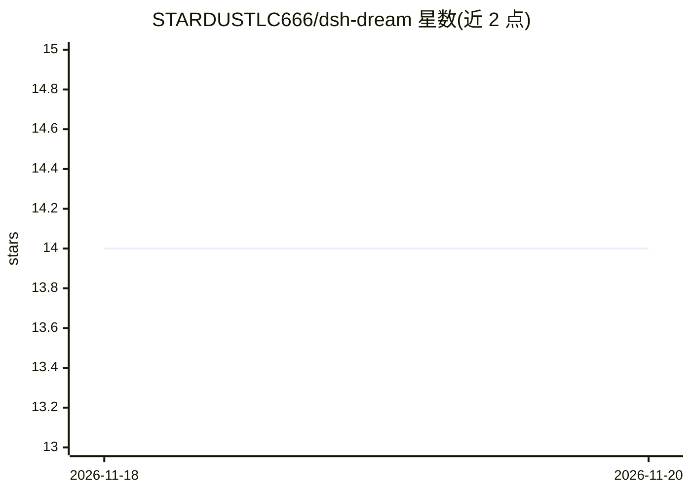

# STARDUSTLC666/dsh-dream

⭐ 14 · JavaScript · MIT · 推送 2026-11-19 · [GitHub](https://github.com/STARDUSTLC666/dsh-dream) · [官网](https://github.com/STARDUSTLC666/dsh-suite) · 个人维护 · 中文 README

**给 DSH 的任务经验记忆插件：复盘任务并回用经验**

DeepSeek Harness（DSH）的原生插件，在任务结束后按开关与额度整理候选经验，用户在工作台核对来源、适用范围、条件与例外后决定采纳或写入 AGENTS.md，后续相关任务中取回已确认经验并保留来源与写入审计。候选不会自动采纳；自动整理消耗当前会话模型额度。通过 DSH 桌面版插件面板或 dsh plugin 命令行安装，要求宿主 >=0.2.2-rc.3，提供反向代理白名单配置。

## 筛选速览

| 维度 | 判定 | 备注 |
|---|---|---|
| AI 角色 | `ai-ecosystem` | LLM/agent 周边工具 |
| 许可风险 | `permissive` | MIT |
| 部署形态 | `None` |  |
| 模型依赖 | locked-api |  |
| 硬件要求 | — | 无带数字的原话,不猜 |
| 安装摩擦 | `low` | 无编译、无系统依赖或容器化 |
| 成熟度 | — | 结构信号不足 |

## 能力要点

- 任务复盘候选整理与人工审阅采纳流程
- 经验写入 AGENTS.md 并保留来源与写入审计
- 相关任务中自动取回已确认经验
- 5 套可切换工作台视觉风格与 8 种界面语言

## 适用场景

- 让 DSH 把做过的任务整理成可复用经验
- 相关新任务时自动取回过往确认过的经验参考
- 通过反向代理在远程访问插件工作台

## 场景标签

`Agent 记忆` · 领域:Agent 开发

## 证据(README 行号)

> L5: **DeepSeek Harness 原生任务经验记忆插件：让 DSH 把做过的任务，变成下次用得上的经验。**
> L17: - 实际任务结束后，按开关与额度整理候选经验。
> L19: - 在相关任务中回用已确认经验，并保留来源记录与写入审计。

## 星数曲线

2026-11-18 14 → 2026-11-20 14（+0）

---
*卡片 v1 · prompt 1.4 · 生成 2026-11-18 · 置信度 high · 依据 README sha `dd7bcf199606` · [字段定义](../../DATASET.md)*
