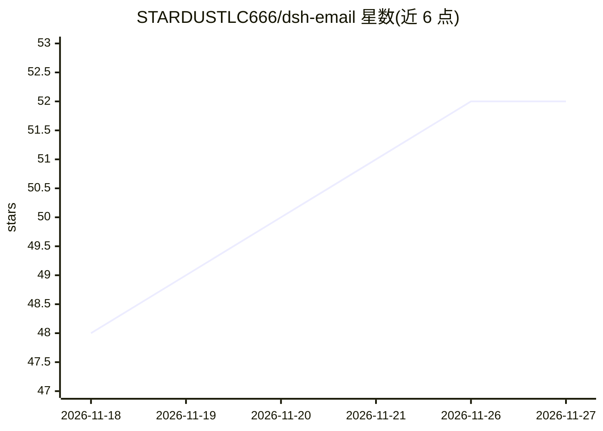

# STARDUSTLC666/dsh-email

⭐ 52 · JavaScript · MIT · 推送 2026-11-26 · [GitHub](https://github.com/STARDUSTLC666/dsh-email) · [官网](https://github.com/STARDUSTLC666/dsh-suite) · 个人维护 · 中文 README

**DeepSeek Harness 的邮件工作台插件：收发邮件、草稿确认后发送**

DSH（DeepSeek Harness）的邮件插件：支持 IMAP/POP3/SMTP、Google/Outlook OAuth 与 AgentMail 多账号管理，含腾讯企业邮预设与自定义内网服务器。用户在工作台浏览邮件、搜索下载附件、编辑 HTML/纯文本回复草稿，核对收件人与附件后立即或定时发送。助手可先准备回复草稿、经用户确认后发出。界面支持五种主题与八种语言。定时发送需保持 DSH 运行；Gmail OAuth 需自行创建 Google 客户端。

## 筛选速览

| 维度 | 判定 | 备注 |
|---|---|---|
| AI 角色 | `ai-ecosystem` | LLM/agent 周边工具 |
| 许可风险 | `permissive` | MIT |
| 部署形态 | `None` |  |
| 模型依赖 | locked-api |  |
| 硬件要求 | — | 无带数字的原话,不猜 |
| 安装摩擦 | `low` | 无编译、无系统依赖或容器化 |
| 成熟度 | — | 结构信号不足 |

## 能力要点

- IMAP/POP3/SMTP、Google/Outlook OAuth 与 AgentMail 多账号，支持自定义内网服务器
- 草稿编辑与收件人核对后才发送，可定时发送
- IMAP 自建文件夹管理（只删空文件夹，系统目录受保护）
- 其他插件可用 emailTasks 订阅新邮件到达，不读取正文

## 适用场景

- 让 DSH 助手读取邮箱并准备回复草稿，我核对后再发送
- 在内网/自建邮件服务器环境下收发邮件
- 多账号（含腾讯企业邮、Gmail、Outlook）统一管理邮件

## 场景标签

`AI 助手` · 领域:对话与助手

## 证据(README 行号)

> L5: **DeepSeek Harness 邮件工作台：收发邮件、编辑图文草稿、核对后再定时或立即发送，支持五种界面主题实时切换。**
> L48: 3. 搜索并打开邮件，核对正文与附件；可让助手“准备回复，先不要发送”。

## 星数曲线

2026-11-18 48 → 2026-11-27 52（+4）

---
*卡片 v1 · prompt 1.4 · 生成 2026-11-18 · 置信度 high · 依据 README sha `e68c9e415d84` · [字段定义](../../DATASET.md)*
