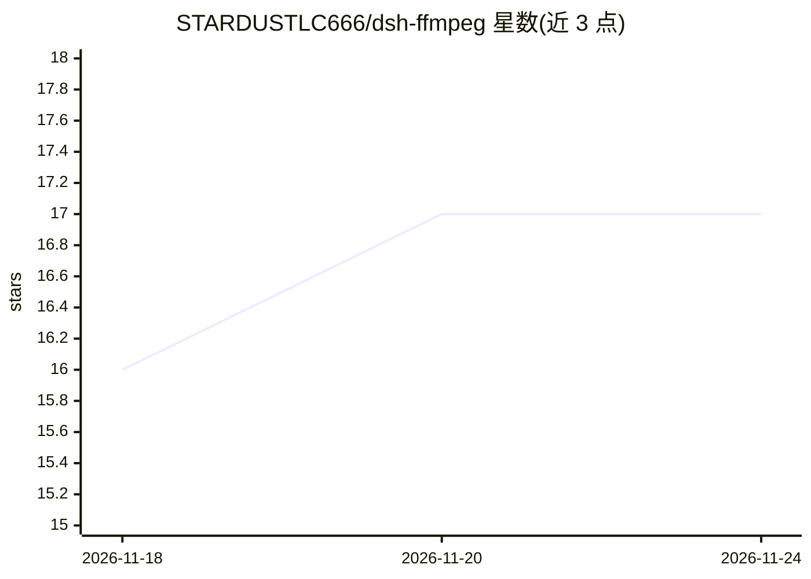

# STARDUSTLC666/dsh-ffmpeg

⭐ 17 · JavaScript · MIT · 推送 2026-11-23 · [GitHub](https://github.com/STARDUSTLC666/dsh-ffmpeg) · [官网](https://github.com/STARDUSTLC666/dsh-suite) · 个人维护 · 中文 README

**DeepSeek Harness 的本机 FFmpeg 音视频处理插件**

面向 DeepSeek Harness（DSH）>=0.2.2-rc.3 的桌面/网页版插件，封装本机 FFmpeg/FFprobe，为 agent 助手提供媒体探测、裁切拼接、预设转码、字幕烧录、分镜总览图与 GIF 导出等工具，兼容 Windows 滤镜路径转义。需要本机已安装 FFmpeg/ffprobe 并通过 ffmpeg_health 检查。默认保留源文件，输出成品需实际播放核对后交付。通过 DSH 插件面板或命令行安装，MIT 许可。

## 筛选速览

| 维度 | 判定 | 备注 |
|---|---|---|
| AI 角色 | `ai-ecosystem` | LLM/agent 周边工具 |
| 许可风险 | `permissive` | MIT |
| 部署形态 | `None` |  |
| 模型依赖 | locked-api |  |
| 硬件要求 | — | 无带数字的原话,不猜 |
| 安装摩擦 | `medium` | 含编译或系统依赖之一 |
| 成熟度 | — | 结构信号不足 |

## 能力要点

- 封装 FFmpeg/FFprobe：探测、剪辑拼接、预设转码、字幕烧录、抽帧与 GIF 导出
- ffmpeg_storyboard 生成带采样时间的视频总览图辅助定位片段
- 兼容 Windows 滤镜路径转义
- 默认保留源文件，重名成品另取文件名

## 适用场景

- 在 DeepSeek Harness 中用自然语言指挥剪辑、转码、加字幕
- 先让助手生成视频总览图再挑选要裁切的片段
- 把本机音视频文件转成指定规格成品或 GIF

## 场景标签

`图像视频处理` · 领域:感知与多模态

## 证据(README 行号)

> L7: DeepSeek Harness（`>=0.2.2-rc.3`）本机音视频处理插件：封装 FFmpeg / FFprobe 进行媒体探测、剪辑拼接、预设转码、字幕烧录、分镜总览图与 GIF 导出，兼容 Windows 滤镜路径转义。
> L33: 1. 安装 FFmpeg/ffprobe，并在 DSH 中运行 ffmpeg_health 检查可执行文件。

## 星数曲线

2026-11-18 16 → 2026-11-24 17（+1）

---
*卡片 v1 · prompt 1.4 · 生成 2026-11-18 · 置信度 high · 依据 README sha `a8c4b478443c` · [字段定义](../../DATASET.md)*
