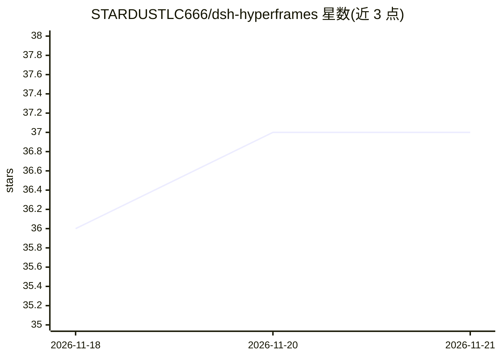

# STARDUSTLC666/dsh-hyperframes

⭐ 37 · JavaScript · MIT · 推送 2026-11-20 · [GitHub](https://github.com/STARDUSTLC666/dsh-hyperframes) · [官网](https://github.com/STARDUSTLC666/dsh-suite) · 个人维护 · 中文 README

**DeepSeek Harness 插件：用 HTML 创作视频并导出 MP4**

运行于 DeepSeek Harness（>=0.2.2-rc.3）桌面版/网页版的插件，提供工作台界面：从标题卡、产品介绍、图文轮播等模板出发，编辑内容、上传素材并调整图片顺序，在浏览器中预览，经本机渲染环境导出 MP4，工程保持可编辑并可搜索、排序与归档恢复。工作台与弹窗支持五套明亮主题切换。安装通过 DSH 插件面板或命令行完成，首次使用需准备官方渲染环境，工程修改后需重新导出。

## 筛选速览

| 维度 | 判定 | 备注 |
|---|---|---|
| AI 角色 | `ai-ecosystem` | LLM/agent 周边工具 |
| 许可风险 | `permissive` | MIT |
| 部署形态 | `None` |  |
| 模型依赖 | locked-api |  |
| 硬件要求 | — | 无带数字的原话,不猜 |
| 安装摩擦 | `low` | 无编译、无系统依赖或容器化 |
| 成熟度 | — | 结构信号不足 |

## 能力要点

- 模板起步（标题卡/产品介绍/图文轮播）+ 素材上传与排序
- 浏览器预览与本机渲染导出 MP4，保留可编辑工程
- 工程库搜索、排序与归档恢复
- 五套明亮工作台主题切换，适配 DSH >=0.2.2-rc.3

## 适用场景

- 在 DeepSeek Harness 里让 agent 按文案制作 HTML 产品介绍视频并导出 MP4
- 维护可编辑的视频工程，随时修改后重新导出
- 按主题偏好切换工作台界面

## 场景标签

`视频生成` · 领域:内容生成

## 证据(README 行号)

> L5: **在 DeepSeek Harness 中用 HTML 创作并导出视频，内置可切换五套明亮风格的工作台界面。**
> L28: 在 DSH 桌面版「插件」面板安装 `dsh-hyperframes`。已配置命令行时也可使用：

## 星数曲线

2026-11-18 36 → 2026-11-21 37（+1）

---
*卡片 v1 · prompt 1.4 · 生成 2026-11-18 · 置信度 high · 依据 README sha `293d01a37752` · [字段定义](../../DATASET.md)*
