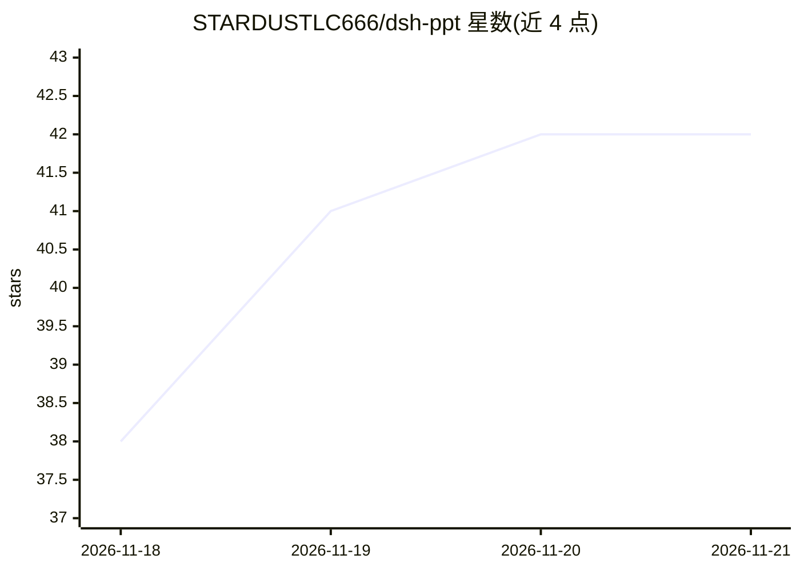

# STARDUSTLC666/dsh-ppt

⭐ 42 · JavaScript · MIT · 推送 2026-11-20 · [GitHub](https://github.com/STARDUSTLC666/dsh-ppt) · [官网](https://github.com/STARDUSTLC666/dsh-suite) · 个人维护 · 中文 README

**DeepSeek Harness 的演示文稿生成与编辑插件**

运行于 DeepSeek Harness（DSH）内的 PPT 生成插件：用户提供材料后自动匹配 18 套主题、6 套母版骨架与 24 种可编辑版式，产出离线 HTML 放映、可编辑 PPTX 与完整工程包。工作台支持按页编辑、HTML/PPTX 并排对比与撤销，可解析外部 .pptx 吸收配色与母版骨架。可选 AI 叙事预审、模拟答辩与视觉审查（限 24 页）。通过 DSH 桌面版插件面板或 dsh 命令行安装，宿主要求 >=0.2.2-rc.3。

## 筛选速览

| 维度 | 判定 | 备注 |
|---|---|---|
| AI 角色 | `ai-native` | 本体是模型或模型工具 |
| 许可风险 | `permissive` | MIT |
| 部署形态 | `None` |  |
| 模型依赖 | locked-api |  |
| 硬件要求 | — | 无带数字的原话,不猜 |
| 安装摩擦 | `low` | 无编译、无系统依赖或容器化 |
| 成熟度 | — | 结构信号不足 |

## 能力要点

- 从材料生成离线 HTML、可编辑 PPTX 与工程包三种交付物
- 18 套主题 / 6 套母版骨架 / 24 种可编辑版式，含甘特图、哈维球矩阵等图示
- ppt_absorb 与拖拽方式解析外部 .pptx 的色板、字体、Logo 与母版骨架
- 可选数字推演、AI 视觉审查与模拟答辩（最多 24 页）

## 适用场景

- 把文档或一句话材料转成可交付的汇报演示文稿
- 吸收既有企业模板风格生成新 PPT
- 在浏览器工作台按页精修版式后导出 PPTX

## 场景标签

`AI 写作` · 领域:内容生成

## 证据(README 行号)

> L5: **在 DeepSeek Harness 中将材料整理为有审美品味、可直接交付的演示文稿，导出离线 HTML、可编辑 PPTX 与工程包，内置可切换五套明亮风格的工作台界面。**
> L15: - **零品味负担自动导演**：无需懂排版配色，一句话或文档自动匹配 **18 套大师主题**（12 套明亮投影友好 + 6 套沉浸深色）与 **6 套差异化母版骨架**（麦肯锡直角 / Apple 空间留白 / 杂志社论书脊 /

## 星数曲线

2026-11-18 38 → 2026-11-21 42（+4）

---
*卡片 v1 · prompt 1.4 · 生成 2026-11-18 · 置信度 high · 依据 README sha `5b7a7ba34c84` · [字段定义](../../DATASET.md)*
