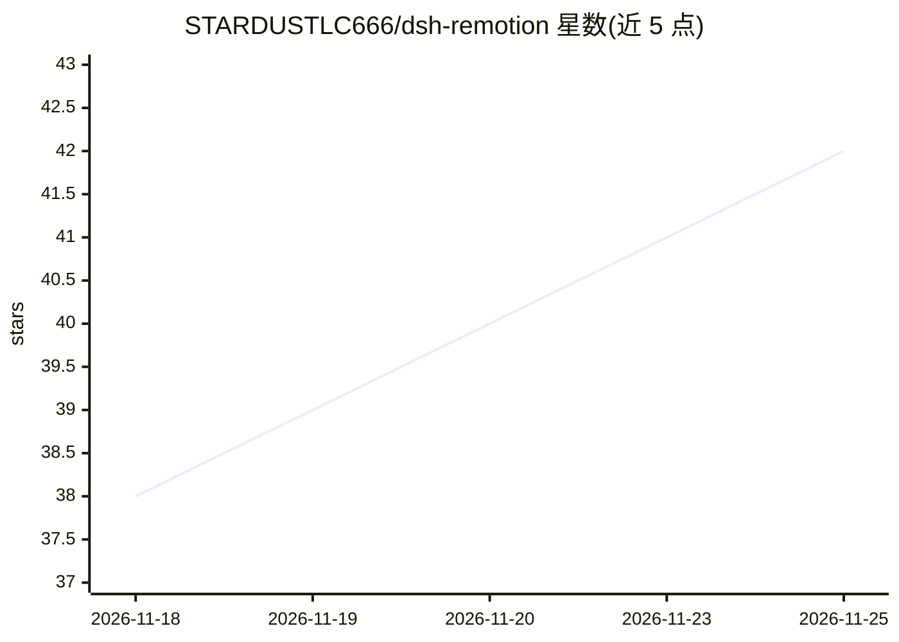

# STARDUSTLC666/dsh-remotion

⭐ 42 · JavaScript · MIT · 推送 2026-11-23 · [GitHub](https://github.com/STARDUSTLC666/dsh-remotion) · [官网](https://github.com/STARDUSTLC666/dsh-suite) · 个人维护 · 中文 README

**DeepSeek Harness 的 Remotion 视频创作插件：React 工程导出 MP4**

DeepSeek Harness（DSH）的插件，把 React 工程制作并导出为视频：提供官方 Remotion 技能与工作台模板，管理工程、素材顺序与 Studio 预览，导出本机 MP4 并保留可编辑工程备份，工程库支持搜索与归档。适配 DSH >=0.2.2-rc.3，含五套明亮主题切换。通过 DSH 桌面版插件面板或命令行安装，首次使用需在插件内准备官方渲染环境。

## 筛选速览

| 维度 | 判定 | 备注 |
|---|---|---|
| AI 角色 | `ai-enhanced` | 去掉 AI 部分产品仍成立 |
| 许可风险 | `permissive` | MIT |
| 部署形态 | `None` |  |
| 模型依赖 | locked-api |  |
| 硬件要求 | — | 无带数字的原话,不猜 |
| 安装摩擦 | `low` | 无编译、无系统依赖或容器化 |
| 成熟度 | — | 结构信号不足 |

## 能力要点

- 使用官方 Remotion 技能与工作台模板
- Studio 预览后导出本机 MP4，保留可编辑工程备份
- 素材管理与工程库搜索归档
- 五套明亮工作台主题切换，适配 DSH >=0.2.2-rc.3

## 适用场景

- 在 DeepSeek Harness 里用 React 制作程序化视频
- 上传图片音频素材并预览后导出 MP4
- 管理多个视频工程并归档整理

## 场景标签

`视频生成` · 领域:内容生成

## 证据(README 行号)

> L5: **在 DeepSeek Harness 中把 React 工程制作并导出为视频，内置可切换五套明亮风格的工作台界面。**
> L15: - 使用官方技能与工作台模板。

## 星数曲线

2026-11-18 38 → 2026-11-25 42（+4）

---
*卡片 v1 · prompt 1.4 · 生成 2026-11-18 · 置信度 mid · 依据 README sha `bab4dd1543f0` · [字段定义](../../DATASET.md)*
