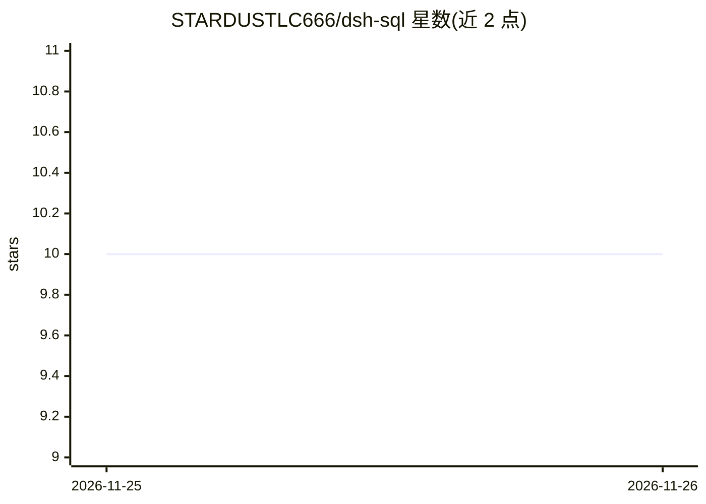

# STARDUSTLC666/dsh-sql

⭐ 10 · JavaScript · MIT · 推送 2026-11-25 · [GitHub](https://github.com/STARDUSTLC666/dsh-sql) · [官网](https://github.com/STARDUSTLC666/dsh-suite) · 个人维护 · 中文 README

**给 DeepSeek Harness 用的安全多引擎数据库插件**

DeepSeek Harness（>=0.2.2-rc.3）的数据库插件：统一管理 SQLite/MySQL/PostgreSQL 多连接，支持粘贴 URL 与 TLS/SSL 配置；可一次并发探查最多 20 张表的结构、索引与外键。查询强制走引擎级只读事务并带行数上限，敏感列通过 redactColumns 自动打码为 [REDACTED]，写入类 SQL 经参数化审批卡逐条确认后执行，支持 Markdown/CSV/JSON 导出。经 DSH 插件面板或 dsh CLI 安装。

## 筛选速览

| 维度 | 判定 | 备注 |
|---|---|---|
| AI 角色 | `ai-native` | 本体是模型或模型工具 |
| 许可风险 | `permissive` | MIT |
| 部署形态 | `None` |  |
| 模型依赖 | locked-api |  |
| 硬件要求 | — | 无带数字的原话,不猜 |
| 安装摩擦 | `low` | 无编译、无系统依赖或容器化 |
| 成熟度 | — | 结构信号不足 |

## 能力要点

- 引擎级只读：SQLite PRAGMA query_only 与 MySQL/PG 只读事务
- 敏感列脱敏 redactColumns 热生效，密码支持环境变量
- 高危 SQL（DROP/TRUNCATE/无 WHERE 删改）审批门
- 最多 20 张表并发结构探查

## 适用场景

- 让 AI 助手只读分析数据库并导出 CSV 报表
- 陌生数据库盘点表结构与业务表关系
- 需要审批确认后再执行改数操作的运维场景

## 场景标签

`数据分析` · 领域:效率与自动化

## 证据(README 行号)

> L7: DeepSeek Harness（`>=0.2.2-rc.3`）多引擎数据库插件：统一支持 SQLite、MySQL 与 PostgreSQL，提供可视化热生效设置面板、一键连通性测试、引擎级只读保护、敏感列脱敏与高危写操作审批门。
> L21: |**引擎级只读查询**|`sql_query` 强制走 SQLite `PRAGMA query_only` 与 MySQL/PG 只读事务（含 PG 游标复用与服务端超时），支持行数上限、`params` 参数化及 Markd

## 星数曲线

2026-11-25 10 → 2026-11-26 10（+0）

---
*卡片 v1 · prompt 1.4 · 生成 2026-11-24 · 置信度 high · 依据 README sha `c800e94e81c2` · [字段定义](../../DATASET.md)*
