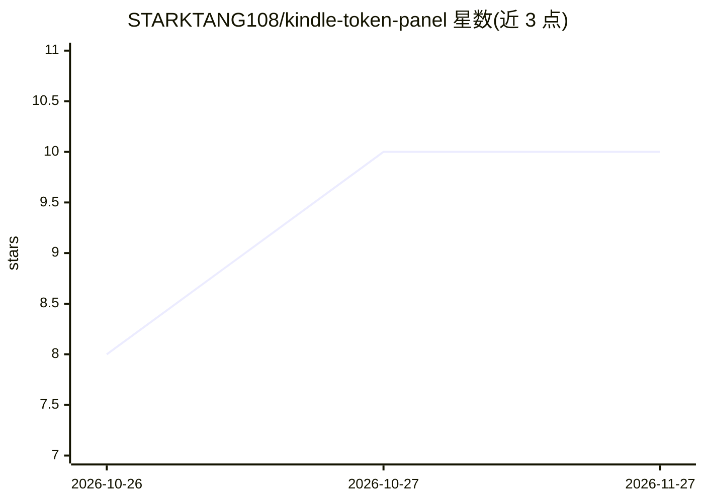

# STARKTANG108/kindle-token-panel

⭐ 10 · Python · MIT · 推送 2026-10-24 · [GitHub](https://github.com/STARKTANG108/kindle-token-panel) · 个人维护 · 中文 README

**将闲置 Kindle 改造成 AI Token 用量与 Agent 任务进度墨水屏看板**

一个纯 Python 3 标准库实现的监控面板服务，将未越狱的 Kindle（含咪咕版）通过其内置体验版浏览器变成实时墨水屏看板，展示 LLM Token 用量、费用、模型排行，以及多渠道在途 Agent 任务进度。数据以只读方式连接外部 SQLite，通过 HTTP 304 机制避免墨水屏重绘闪烁。提供 kpanel CLI 推送自定义任务进度，并可作为 Agent Skill 安装至 Claude Code、Antigravity 等智能体框架。依赖 Python 3.8+，macOS 可配置开机自启。

## 筛选速览

| 维度 | 判定 | 备注 |
|---|---|---|
| AI 角色 | `ai-ecosystem` | LLM/agent 周边工具 |
| 许可风险 | `permissive` | MIT |
| 部署形态 | `library` | 以包/库形式分发 |
| 模型依赖 | — | README 未给出锁定关系 |
| 硬件要求 | — | 无带数字的原话,不猜 |
| 安装摩擦 | `low` | 无编译、无系统依赖或容器化 |
| 成熟度 | — | 结构信号不足 |

## 能力要点

- 零第三方依赖，纯 Python 标准库实现，无需 pip install
- HTTP 304 零重绘机制配合 GC16 全刷，减少墨水屏闪烁与残影
- 四通道任务监控：Antigravity 会话、Token Monitor 客户端、本地脚本、自定义上报
- 内置电子书生成器通过 MTP 推送跳板书，唤醒咪咕版隐藏浏览器

## 适用场景

- 把闲置 Kindle 变成桌面常亮的 Token 用量看板
- 在墨水屏上实时查看多个 Agent 任务的执行进度
- 用 kpanel 把爬虫、训练流水线进度推送到 Kindle 屏幕

## 场景标签

`LLM 可观测性` · 领域:评测与运维

## 证据(README 行号)

> L10: *Turn any idle Kindle (including Kindle X Migu) into an ambient, zero-dependency, e-ink dashboard for real-time LLM

## 星数曲线

2026-10-26 8 → 2026-11-27 10（+2）

---
*卡片 v1 · prompt 1.4 · 生成 2026-11-20 · 置信度 mid · 依据 README sha `93fb1ad41155` · [字段定义](../../DATASET.md)*
