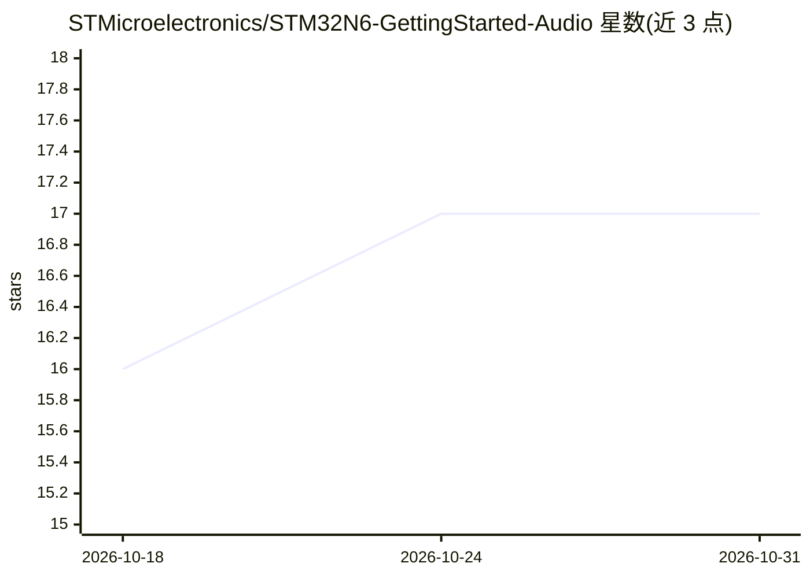

# STMicroelectronics/STM32N6-GettingStarted-Audio

⭐ 17 · C · NOASSERTION · 推送 2026-04-16 · [GitHub](https://github.com/STMicroelectronics/STM32N6-GettingStarted-Audio) · 组织维护

**STM32N6 上音频事件检测与语音增强的嵌入式 AI 示例包**

ST 官方发布的 STM32N6 入门软件包：在 MB1939 STM32N6570-DK 开发板上实时运行 X-CUBE-AI 生成的音频模型，链路为传感器采集→预处理特征提取→ML 推理→后处理输出，提供裸机、FreeRTOS 及各自低功耗共四种构建配置，含音频事件检测（AED，识别婴儿啼哭、时钟滴答等）与语音增强（SE）两个用例。提供预编译二进制直接烧写，或经 STM32CubeIDE/Makefile 从源码构建，附 model zoo 脚本部署自定义 ONNX 模型。限制：需指定开发板与 ST 工具链（STM32CubeIDE、STM32CubeProgrammer、STEdgeAI）。

## 筛选速览

| 维度 | 判定 | 备注 |
|---|---|---|
| AI 角色 | `ai-native` | 本体是模型或模型工具 |
| 许可风险 | `none` | NOASSERTION |
| 部署形态 | `desktop` | 安装包/桌面程序 |
| 模型依赖 | — | README 未给出锁定关系 |
| 硬件要求 | — | 无带数字的原话,不猜 |
| 安装摩擦 | `low` | 无编译、无系统依赖或容器化 |
| 成熟度 | — | 结构信号不足 |

## 能力要点

- AED 与 SE 两个用例，四种构建配置（裸机/FreeRTOS × 标准/低功耗）
- 提供预编译 hex 二进制与 flash-bin.sh 一键烧写流程
- model zoo 脚本支持部署自定义 ONNX 模型（如 Yamnet）
- 实现随机负载生成与音频处理旁路对比功能

## 适用场景

- 在 STM32N6570-DK 板上运行音频事件检测识别环境声音
- 实时语音增强并通过耳机对比原始与处理后音频
- 学习并替换嵌入式音频 AI 模型的部署流程

## 场景标签

 · 领域:嵌入式/边缘AI音频

## 证据(README 行号)

> L3: This project provides an STM32 Microcontroler embedded real time environement
> L67:  1. Audio Event Detection (aed): Automatically recognizing events like a baby
> L69:  2. Speech Enhancement (se): Improve quality and intelligibility of speech

## 星数曲线

2026-10-18 16 → 2026-10-31 17（+1）

---
*卡片 v1 · prompt 1.4 · 生成 2026-10-29 · 置信度 mid · 依据 README sha `a45732881c2e` · [字段定义](../../DATASET.md)*
