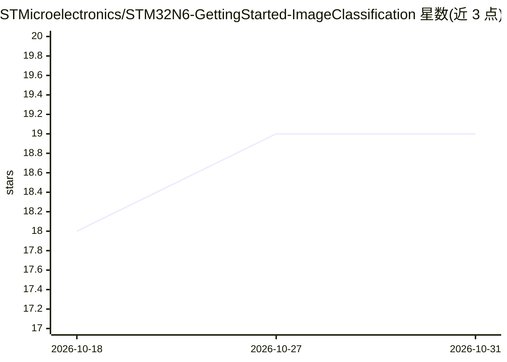

# STMicroelectronics/STM32N6-GettingStarted-ImageClassification

⭐ 19 · C · NOASSERTION · 推送 2026-09-09 · [GitHub](https://github.com/STMicroelectronics/STM32N6-GettingStarted-ImageClassification) · 组织维护

**STM32N6 微控制器图像分类示例：NPU 加速运行量化模型**

ST 官方提供的 STM32N6 嵌入式图像分类应用示例：通过摄像头采集图像，在片上 NPU 加速运行 STEdgeAI 生成的量化模型（EfficientNet/MobileNet，推理 1-44ms），在显示屏或 USB/UVC 上展示检测类别与置信度。支持 STM32N6570-DK 与 NUCLEO-N657X0-Q 两块开发板，可用预编译 hex 直接烧录，或经 STM32CubeIDE/Makefile 从源码构建。该项目同时作为 ST ModelZoo 部署服务的子模块。限制：仅测试 RGB888 输入、仅支持 UINT8 输入格式。

## 筛选速览

| 维度 | 判定 | 备注 |
|---|---|---|
| AI 角色 | `ai-native` | 本体是模型或模型工具 |
| 许可风险 | `none` | NOASSERTION |
| 部署形态 | `None` |  |
| 模型依赖 | — | README 未给出锁定关系 |
| 硬件要求 | — | 无带数字的原话,不猜 |
| 安装摩擦 | `medium` | 含编译或系统依赖之一 |
| 成熟度 | — | 结构信号不足 |

## 能力要点

- NPU 加速的量化 AI 模型推理（1-44 ms）
- 提供预编译 hex 二进制与源码构建两条路径
- 支持 STM32N6570-DK 与 NUCLEO-N657X0-Q 两块板及多种摄像头/显示模块
- 作为 ST ModelZoo 部署服务的 C 应用子模块

## 适用场景

- 在 STM32N6 开发板上快速跑通实时图像分类 demo
- 作为自定义图像分类模型部署到 STM32N6 的起点工程
- 配合 ST ModelZoo 服务将训练好的模型自动部署到硬件

## 场景标签

`目标检测` · 领域:感知与多模态

## 证据(README 行号)

> L3: This project provides a real-time embedded environment for STM32N6 microcontroller to execute STEdgeAI generated mod
> L17: - NPU-accelerated quantized AI model inference

## 星数曲线

2026-10-18 18 → 2026-10-31 19（+1）

---
*卡片 v1 · prompt 1.4 · 生成 2026-10-28 · 置信度 high · 依据 README sha `6d48227076d8` · [字段定义](../../DATASET.md)*
