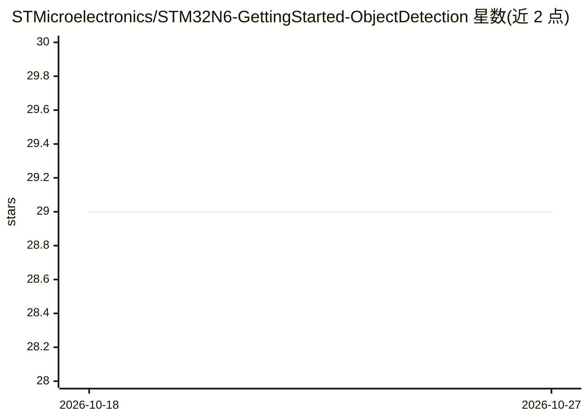

# STMicroelectronics/STM32N6-GettingStarted-ObjectDetection

⭐ 29 · C · NOASSERTION · 推送 2026-09-09 · [GitHub](https://github.com/STMicroelectronics/STM32N6-GettingStarted-ObjectDetection) · 组织维护

**STM32N6 微控制器上的实时目标检测示例工程**

ST 官方提供的 STM32N6 嵌入式目标检测应用包：在 NPU 上运行 STEdgeAI 生成的量化模型（如 st_yolo_x_nano、tiny_yolo_v2，int8 TFLite），从摄像头取流并实时绘制边界框与置信度。支持 STM32N6570-DK 与 NUCLEO-N657X0-Q 两块开发板，提供预编译二进制、STM32CubeIDE 与 Makefile 两种源码构建路径，也作为 ModelZoo 部署服务的子模块使用。限制：仅测试 RGB888 输入，仅支持 UINT8 输入格式。

## 筛选速览

| 维度 | 判定 | 备注 |
|---|---|---|
| AI 角色 | `ai-native` | 本体是模型或模型工具 |
| 许可风险 | `none` | NOASSERTION |
| 部署形态 | `None` |  |
| 模型依赖 | — | README 未给出锁定关系 |
| 硬件要求 | — | 无带数字的原话,不猜 |
| 安装摩擦 | `medium` | 含编译或系统依赖之一 |
| 成熟度 | — | 结构信号不足 |

## 能力要点

- NPU 加速的量化模型推理（推理时间 27-30 ms）
- 支持 STM32N6570-DK 与 NUCLEO-N657X0-Q，多种摄像头/显示模块
- 提供预编译二进制、CubeIDE 与 Makefile 三种运行路径
- 集成到 ST ModelZoo 的自动部署流程

## 适用场景

- 在 STM32N6 开发板上跑通实时目标检测示例
- 作为嵌入式目标检测二次开发的起点
- 通过 ModelZoo 部署自己训练的检测模型

## 场景标签

`目标检测` · 领域:感知与多模态

## 证据(README 行号)

> L3: This project provides a real-time embedded environment for STM32N6 microcontroller to execute STEdgeAI generated mod
> L17: - NPU-accelerated quantized AI model inference

## 星数曲线

2026-10-18 29 → 2026-10-27 29（+0）

---
*卡片 v1 · prompt 1.4 · 生成 2026-10-26 · 置信度 high · 依据 README sha `908c75e05d3c` · [字段定义](../../DATASET.md)*
