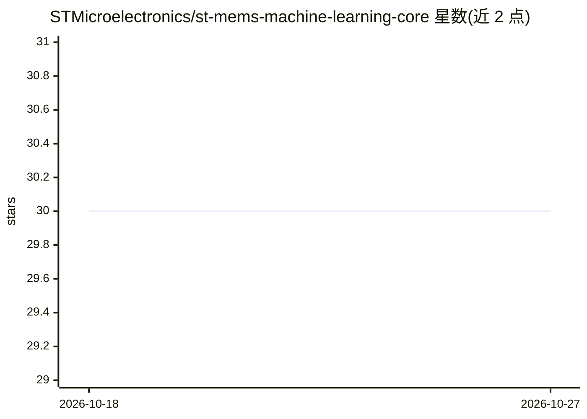

# STMicroelectronics/st-mems-machine-learning-core

⭐ 30 · MATLAB · BSD-3-Clause · 推送 2026-09-25 · [GitHub](https://github.com/STMicroelectronics/st-mems-machine-learning-core) · 组织维护

**ST 传感器内嵌机器学习核心 MLC 的示例、教程与工具集**

STMicroelectronics 维护的仓库，为 MEMS 传感器内置的机器学习核心（MLC）提供示例、教程和开发工具。MLC 通过决策树逻辑在传感器内部直接执行算法，将部分算法从应用处理器移至传感器以降低功耗；决策树节点基于传感器数据的统计参数与阈值做 if-then-else 判断，结果可由应用处理器随时读取，并可在结果变化时产生中断。含 MLC 的产品型号以 "X" 结尾。仓库分 examples、tools、tutorials 三个目录。

## 筛选速览

| 维度 | 判定 | 备注 |
|---|---|---|
| AI 角色 | `ai-ecosystem` | LLM/agent 周边工具 |
| 许可风险 | `permissive` | BSD-3-Clause |
| 部署形态 | `None` |  |
| 模型依赖 | — | README 未给出锁定关系 |
| 硬件要求 | — | 无带数字的原话,不猜 |
| 安装摩擦 | `low` | 无编译、无系统依赖或容器化 |
| 成熟度 | — | 结构信号不足 |

## 能力要点

- 决策树逻辑在传感器内部直接执行，降低功耗
- 决策树结果可由应用处理器读取并支持变化中断
- examples/tools/tutorials 三类内容组织

## 适用场景

- 为 ST MEMS 传感器开发内置决策树应用
- 学习如何在不同 ST 硬件套件上构建 MLC 方案
- 查找 MLC 即用型示例

## 场景标签

`教程课程` · 领域:学习与行业

## 证据(README 行号)

> L3: This repository provides examples, tutorials, and tools for the **MLC**, a dedicated core for machine learning proce
> L7: The machine learning processing capability is obtained through decision tree logic. A decision tree is a mathematica

## 星数曲线

2026-10-18 30 → 2026-10-27 30（+0）

---
*卡片 v1 · prompt 1.4 · 生成 2026-10-26 · 置信度 high · 依据 README sha `841e74d873e3` · [字段定义](../../DATASET.md)*
