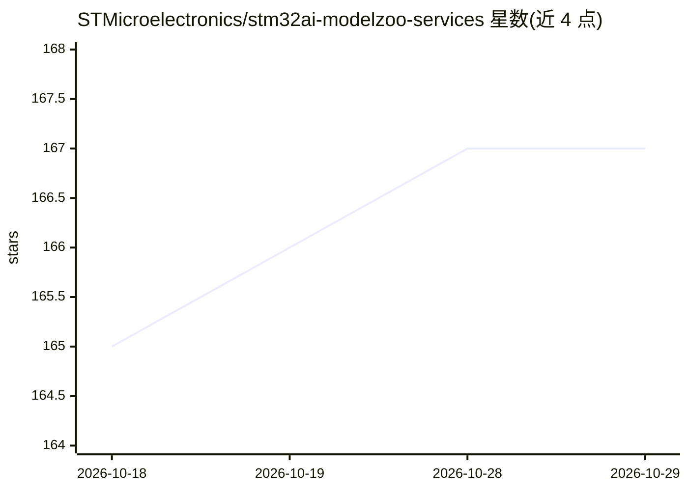

# STMicroelectronics/stm32ai-modelzoo-services

⭐ 167 · C · NOASSERTION · 推送 2026-10-07 · [GitHub](https://github.com/STMicroelectronics/stm32ai-modelzoo-services) · 组织维护

**STM32 嵌入式 AI 模型训练/量化/部署服务脚本集**

STMicroelectronics 维护的 AI 模型 zoo 服务集合：提供训练/微调（BYOD/BYOM）、量化、评估、基准测试、板卡预测与部署代码生成等服务，覆盖图像分类、目标检测、姿态估计、人脸检测、语义分割、音频事件检测等 14 类用例，支持 PyTorch、TensorFlow、ONNX 三种模型格式，面向 STM32 MCU/MPU（H7、N6、MP2、U5 等）部署，通过 .yaml 单一入口配置，可链式执行多个服务。需克隆源码运行。

## 筛选速览

| 维度 | 判定 | 备注 |
|---|---|---|
| AI 角色 | `ai-ecosystem` | LLM/agent 周边工具 |
| 许可风险 | `none` | NOASSERTION |
| 部署形态 | `desktop` | 安装包/桌面程序 |
| 模型依赖 | — | README 未给出锁定关系 |
| 硬件要求 | — | 无带数字的原话,不猜 |
| 安装摩擦 | `medium` | 含编译或系统依赖之一 |
| 成熟度 | — | 结构信号不足 |

## 能力要点

- 训练/量化/评估/基准/部署服务可独立或链式执行，.yaml 单一配置入口
- 支持 PyTorch/TensorFlow/ONNX，含 BYOD/BYOM 自带数据与模型
- 覆盖图像分类、目标检测、姿态估计等 14 类用例
- 提供针对 STM32 参考板卡的模型性能数据与自动生成应用代码

## 适用场景

- 在自有数据集上微调模型并部署到 STM32 开发板
- 量化模型后在目标 MCU 上评估精度与推理时间
- 为 STM32 项目挑选适合目标硬件的预训练模型

## 场景标签

`微调` `模型量化` `模型评测` · 领域:评测与运维

## 证据(README 行号)

> L8: The STM32 AI model zoo is a set of services and scripts used to ease end to end AI models integration on ST devices.
> L12: - A set of services and chained services to quantize, benchmark, predict, and evaluate any model (BYOM)

## 星数曲线

2026-10-18 165 → 2026-10-29 167（+2）

---
*卡片 v1 · prompt 1.4 · 生成 2026-10-22 · 置信度 mid · 依据 README sha `71a71ba632c7` · [字段定义](../../DATASET.md)*
