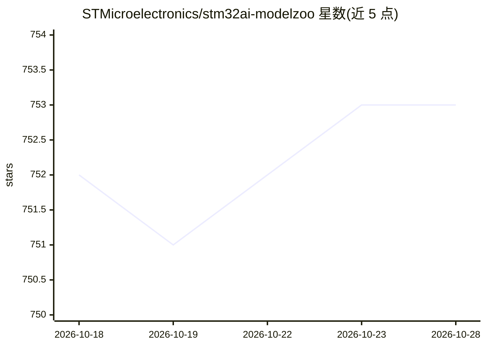

# STMicroelectronics/stm32ai-modelzoo

⭐ 753 · NOASSERTION · 推送 2026-04-21 · [GitHub](https://github.com/STMicroelectronics/stm32ai-modelzoo) · 组织维护

**面向 STM32 微控制器的优化 AI 参考模型库，含多框架预训练模型**

STMicroelectronics 维护的 STM32 嵌入式 AI 模型库：收录图像分类、目标检测、人脸检测、姿态估计、语义/实例分割、深度估计、音频事件检测、语音增强、人体活动识别、弧故障检测、再识别等十余类用例的参考模型，支持 PyTorch、TensorFlow、ONNX 三种框架。提供预训练模型、再训练/量化/评估/基准测试脚本（位于 stm32ai-modelzoo-services 仓库），并给出各模型在参考 STM32 MCU/NPU/MPU 上的 float 与量化性能指标；模型卡托管于 Hugging Face，另有 Docker 化的模型库仪表盘。克隆仓库前需安装 git lfs。

## 筛选速览

| 维度 | 判定 | 备注 |
|---|---|---|
| AI 角色 | `ai-native` | 本体是模型或模型工具 |
| 许可风险 | `none` | NOASSERTION |
| 部署形态 | `None` |  |
| 模型依赖 | — | README 未给出锁定关系 |
| 硬件要求 | — | 无带数字的原话,不猜 |
| 安装摩擦 | `low` | 无编译、无系统依赖或容器化 |
| 成熟度 | — | 结构信号不足 |

## 能力要点

- 覆盖图像/音频/信号十余类用例的参考模型，可再训练或从零训练
- 支持 PyTorch、TensorFlow、ONNX 三种框架
- 提供在参考 STM32 MCU/NPU/MPU 上的 float 与量化性能指标
- 模型卡托管于 Hugging Face，附 Docker 化模型库仪表盘

## 适用场景

- 为 STM32 项目挑选并部署现成的 AI 模型
- 在自有数据集上做迁移学习后量化部署到微控制器
- 对比不同模型在目标 STM32 板卡上的性能指标

## 场景标签

`目标检测` `人脸识别` `模型量化` · 领域:感知与多模态

## 证据(README 行号)

> L8: The STM32 AI model zoo is a collection of reference machine learning models that are optimized to run on STM32
> L13: - A large collection of application-oriented models ready for re-training

## 星数曲线

2026-10-18 752 → 2026-10-28 753（+1）

---
*卡片 v1 · prompt 1.4 · 生成 2026-10-21 · 置信度 high · 依据 README sha `089dde637373` · [字段定义](../../DATASET.md)*
