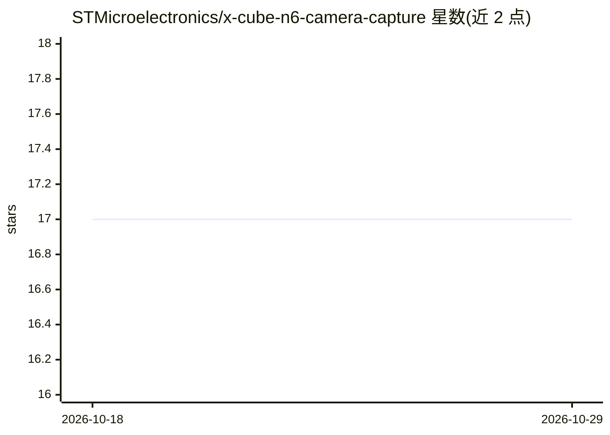

# STMicroelectronics/x-cube-n6-camera-capture

⭐ 17 · C · NOASSERTION · 推送 2026-09-09 · [GitHub](https://github.com/STMicroelectronics/x-cube-n6-camera-capture) · 组织维护

**STM32N6 开发板摄像头采集固件：把板子变成 PC 的 UVC 摄像头**

ST 官方发布的 STM32Cube 扩展软件包：在 STM32N6570-DK 或 NUCLEO-N657X0-Q 板上运行 FreeRTOS 多线程固件，通过 DCMIPP 进行裁剪/抽取/降采样与 ISP 处理，再以 USB UVC（Azure RTOS USBX）把 224x224 到 800x480 的 YUV422 30fps 视频流传输给 PC，供摄像头应用（如 AI 视觉输入）使用。提供可烧录的 Intel hex 固件及 STM32CubeIDE/IAR/Makefile 源码构建路径，配合 IMX335 等摄像头模块。已知问题：切换分辨率流时可能出现稳定性问题需重启应用。

## 筛选速览

| 维度 | 判定 | 备注 |
|---|---|---|
| AI 角色 | `ai-ecosystem` | LLM/agent 周边工具 |
| 许可风险 | `none` | NOASSERTION |
| 部署形态 | `None` |  |
| 模型依赖 | — | README 未给出锁定关系 |
| 硬件要求 | — | 无带数字的原话,不猜 |
| 安装摩擦 | `medium` | 含编译或系统依赖之一 |
| 成熟度 | — | 结构信号不足 |

## 能力要点

- 6 种分辨率（224x224~800x480）YUV422 30fps UVC 视频流，可动态切换
- DCMIPP 裁剪/抽取/降采样与 ISP 处理
- Binary 目录提供两块板、front/rear 两种朝向的即烧 hex 固件
- 支持 STM32CubeIDE / IAR EWARM / Makefile 三种构建方式

## 适用场景

- 把 STM32N6 开发板当作 PC 的外接摄像头，为视觉/AI 应用采集视频
- 学习 STM32N6 的 DCMIPP ISP 与 USB UVC 外设用法
- 在无内置摄像头的设备上接入低成本嵌入式摄像头模块

## 场景标签

`图像视频处理` · 领域:感知与多模态

## 证据(README 行号)

> L3: Computer Vision application to capture video stream using USB UVC on the STM32N6570-DK or NUCLEO-N657X0-Q board.
> L27: This package contains in the Binary directory ready-to-flash Intel hex files for STM32N6570-DK and NUCLEO-N657X0-Q 

## 星数曲线

2026-10-18 17 → 2026-10-29 17（+0）

---
*卡片 v1 · prompt 1.4 · 生成 2026-10-29 · 置信度 mid · 依据 README sha `43ea08cfc116` · [字段定义](../../DATASET.md)*
