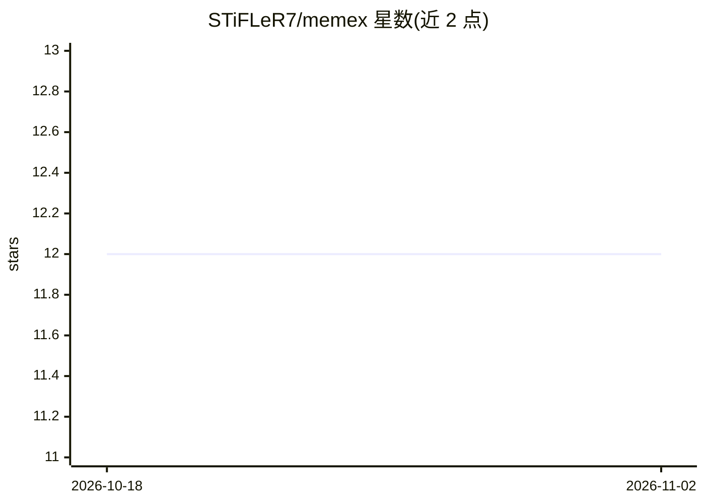

# STiFLeR7/memex

⭐ 12 · Python · MIT · 推送 2026-10-28 · [GitHub](https://github.com/STiFLeR7/memex) · [官网](https://memex.stifler.in) · 个人维护

**为编码 Agent 维护代码库工程上下文的 MCP 服务器与钩子服务**

memex 以守护进程、钩子服务和 MCP 服务器形态，把仓库的提交与文件变更转为双时态知识图谱（模块、符号、决策、问题、证据），存储于 Neo4j（经 Graphiti），并以带新鲜度与出处的 ContextPacket 交付给 Claude Code、Codex、Cursor、Gemini CLI 等编码 Agent。v1 在会话开始时交付有界工作集、编辑前核验依据是否仍成立、恢复时提示需重读的文件，并支持按 worktree 隔离的并行 Agent 视图。运行需自备 Neo4j 5 服务器；检索不可用时 fail-open，不阻断 Agent 执行。提供 14 个 MCP 工具（8 读 4 写 2 分析）与 CLI 统计。

## 筛选速览

| 维度 | 判定 | 备注 |
|---|---|---|
| AI 角色 | `ai-ecosystem` | LLM/agent 周边工具 |
| 许可风险 | `permissive` | MIT |
| 部署形态 | `self-host` | docker 或自建部署 |
| 模型依赖 | — | README 未给出锁定关系 |
| 硬件要求 | — | 无带数字的原话,不猜 |
| 安装摩擦 | `low` | 无编译、无系统依赖或容器化 |
| 成熟度 | — | 结构信号不足 |

## 能力要点

- 把提交与文件变更持续转化为 Neo4j 双时态知识图谱（Graphiti）
- v1 钩子：会话启动工作集、编辑前上下文核验与拦截、恢复变更提示、并行 worktree 视图
- 14 个 MCP 工具：混合检索、影响预测（无 LLM 调用）、决策/问题记录等
- 置信度查询时计算：验证半衰期约 139 天、未验证 30 天过期；失败 fail-open

## 适用场景

- 让 Claude Code / Codex 等 Agent 始终基于最新代码上下文工作
- 编辑前自动核验依据是否因代码变更而失效，拦截过时编辑
- 团队共享部署一套 memex，为多个 Agent 客户端提供仓库工程上下文

## 场景标签

`Agent 记忆` `知识图谱` · 领域:Agent 开发

## 证据(README 行号)

> L9: A daemon, hook service and MCP server that turn commits and file changes into
> L14: memex builds a bitemporal knowledge graph of your repository (modules,
> L170: |Integrations|Hermes MemoryProvider, MCP resources/tools, Claude Code, Cursor, Codex, Gemini CLI|

## 星数曲线

2026-10-18 12 → 2026-11-02 12（+0）

---
*卡片 v1 · prompt 1.4 · 生成 2026-11-01 · 置信度 high · 依据 README sha `2f6e09e20833` · [字段定义](../../DATASET.md)*
