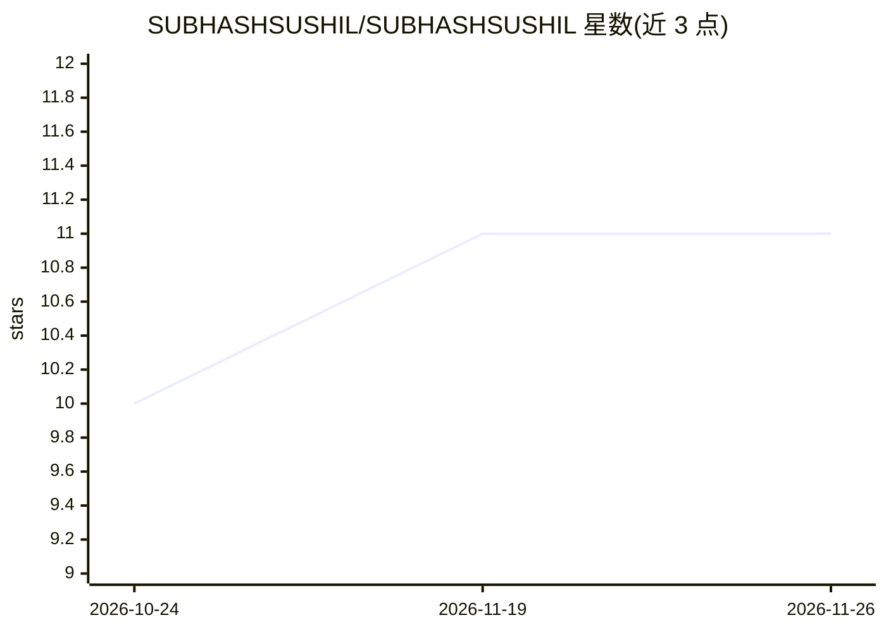

# SUBHASHSUSHIL/SUBHASHSUSHIL

⭐ 11 · 推送 2026-11-18 · [GitHub](https://github.com/SUBHASHSUSHIL/SUBHASHSUSHIL) · 个人维护

**个人 GitHub 主页 README：展示后端与 ML 技术栈**

这是开发者 Sushil Thakur 的 GitHub 个人主页 README，非软件项目。内容为自我介绍（CP Plus 公司 4+ 年后端工程师）、技术栈清单（.NET/C#、Python、PyTorch/TensorFlow/Scikit-Learn、PostgreSQL/RabbitMQ、Azure 等）与 LinkedIn/GitHub 联系方式。无可运行代码、无安装方式、无功能说明，仅为个人技术画像展示页。

## 筛选速览

| 维度 | 判定 | 备注 |
|---|---|---|
| AI 角色 | `ai-enhanced` | 去掉 AI 部分产品仍成立 |
| 许可风险 | `none` | — |
| 部署形态 | `None` |  |
| 模型依赖 | — | README 未给出锁定关系 |
| 硬件要求 | — | 无带数字的原话,不猜 |
| 安装摩擦 | `low` | 无编译、无系统依赖或容器化 |
| 成熟度 | — | 结构信号不足 |

## 能力要点

- 展示个人技术栈清单（语言/框架/ML/数据库/云）
- 提供 LinkedIn 与 GitHub 联系入口
- 包含个人工作经历与能力自述

## 适用场景

- 了解该开发者的技术方向与合作方式
- 作为 profile README 模板参考

## 场景标签

 · 领域:开发者个人主页

## 证据(README 行号)

> L5:  Software Engineer · API & Backend Specialist · ML & AI Enthusiast
> L19: My core expertise spans **API Development**, **Cloud Management**, **Machine Learning**, and **Database Architectur
> L45: ### Machine Learning & Data Science

## 星数曲线

2026-10-24 10 → 2026-11-26 11（+1）

---
*卡片 v1 · prompt 1.4 · 生成 2026-11-19 · 置信度 mid · 依据 README sha `7dd0d78221b6` · [字段定义](../../DATASET.md)*
