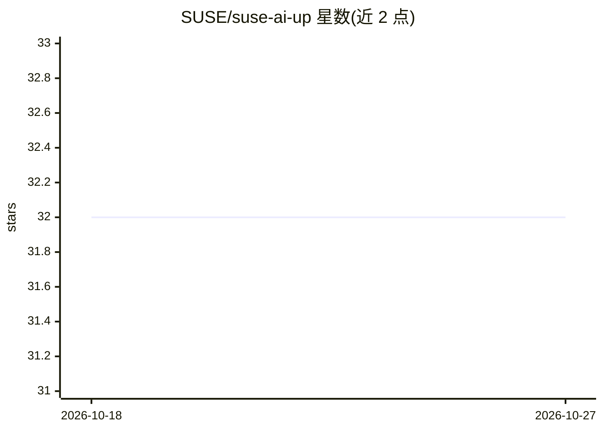

# SUSE/suse-ai-up

⭐ 32 · Go · NOASSERTION · 推送 2026-04-16 · [GitHub](https://github.com/SUSE/suse-ai-up) · 组织维护

**面向运维的 MCP 服务器代理与管理平台**

SUSE 维护的 MCP（Model Context Protocol）通用代理系统：以统一服务提供 MCP 协议 HTTP 代理、会话管理与认证、MCP 服务器注册表（收录 GitHub、Atlassian、Gitea 等 20+ 服务）、网络发现与安全评估、插件编排。采用主容器+sidecar 架构在单个 Kubernetes Pod 内运行，通过 Helm 或 Rancher 部署，HTTP/HTTPS 端口为 8911/3911。本地开发需 Kubernetes 环境。面向在 K8s 集群中统一接入和管理 MCP 服务的团队。

## 筛选速览

| 维度 | 判定 | 备注 |
|---|---|---|
| AI 角色 | `ai-ecosystem` | LLM/agent 周边工具 |
| 许可风险 | `none` | NOASSERTION |
| 部署形态 | `library` | 以包/库形式分发 |
| 模型依赖 | — | README 未给出锁定关系 |
| 硬件要求 | — | 无带数字的原话,不猜 |
| 安装摩擦 | `low` | 无编译、无系统依赖或容器化 |
| 成熟度 | — | 结构信号不足 |

## 能力要点

- MCP 协议 HTTP 代理，含会话管理、认证与协议翻译
- 收录 20+ MCP 服务器的注册表
- 网络扫描自动发现 MCP 服务器并检测认证类型与安全漏洞
- 动态插件系统支持服务注册、健康监控与能力路由

## 适用场景

- 在 Kubernetes 集群中统一代理和接入多个 MCP 服务器
- 通过注册表查找和纳管常用 MCP 服务
- 扫描网络发现 MCP 服务器并评估安全风险

## 场景标签

`模型网关` · 领域:Agent 开发

## 证据(README 行号)

> L7: A comprehensive, modular MCP (Model Context Protocol) proxy system that enables secure, scalable, and extensible AI 
> L28: The system uses a **main container + sidecar architecture** where services run as coordinated containers within a s
> L91: - **Purpose**: Unified MCP proxy service with integrated registry, discovery, and plugin management

## 星数曲线

2026-10-18 32 → 2026-10-27 32（+0）

---
*卡片 v1 · prompt 1.4 · 生成 2026-10-26 · 置信度 high · 依据 README sha `923d3abb2606` · [字段定义](../../DATASET.md)*
