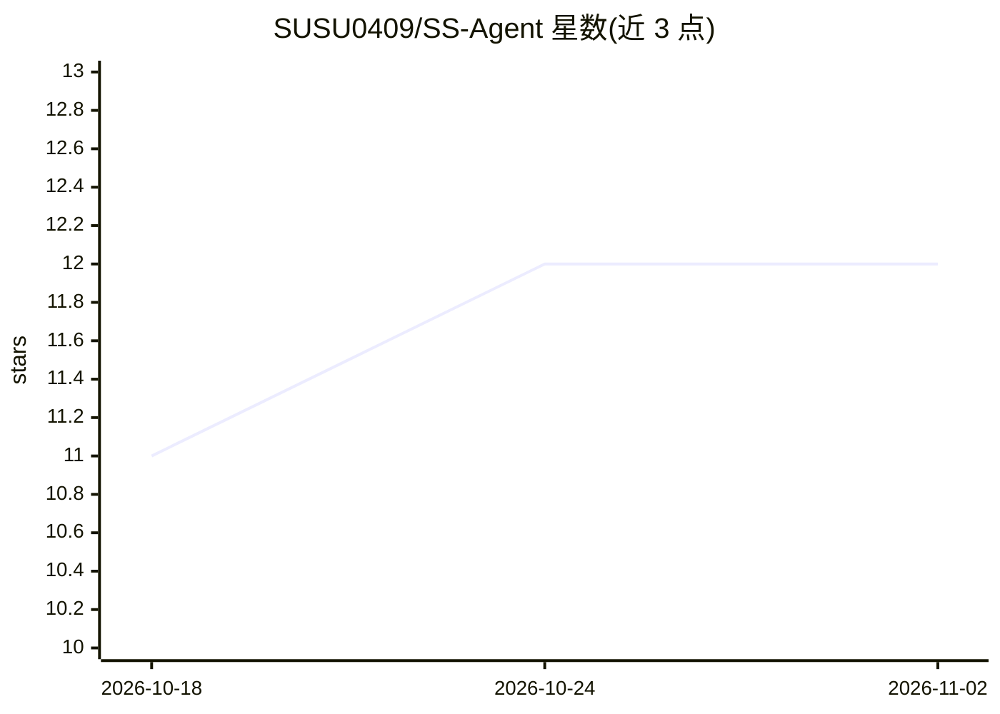

# SUSU0409/SS-Agent

⭐ 12 · Python · MIT · 推送 2026-08-16 · [GitHub](https://github.com/SUSU0409/SS-Agent) · 个人维护 · 中文 README

**面向数学建模竞赛与科研论文全流程的桌面 Agent 工作台**

基于 Electron + FastAPI 的桌面 Agent 工作台，把资料检索、选题、建模、编程实现、实验、绘图、写作、审稿到 PDF/DOCX 导出组织为可暂停、可检查、可继续的工作流。内置 13 项数学建模竞赛（CUMCM、MCM/ICM、华为杯等）模板，并覆盖科研论文、文献综述、审稿回复、基金申请等长流程知识工作。推理依赖 OpenAI 兼容 API 或 Claude CLI，需自行配置模型服务。当前为 1.7.0 MIT 源码版，前端仅提供清理后的可运行 bundle 而非原始 React 工程；桌面端仅支持 Windows 10/11 x64。

## 筛选速览

| 维度 | 判定 | 备注 |
|---|---|---|
| AI 角色 | `ai-native` | 本体是模型或模型工具 |
| 许可风险 | `permissive` | MIT |
| 部署形态 | `desktop` | 安装包/桌面程序 |
| 模型依赖 | locked-api |  |
| 硬件要求 | — | 无带数字的原话,不猜 |
| 安装摩擦 | `low` | 无编译、无系统依赖或容器化 |
| 成熟度 | — | 结构信号不足 |

## 能力要点

- 内置 13 项数学建模竞赛的中文/英文论文工作流模板
- 资料检索到导出的全流程工作流，可暂停、检查、继续
- 支持 OpenAI 兼容 API 与 Claude CLI 作为模型通道，可分配执行/审稿/编辑角色
- 可选集成 AMiner 文献检索、Pandoc、Draw.io、MiKTeX/TeX Live

## 适用场景

- 参加 CUMCM、美赛、华为杯等数学建模竞赛时完成从解题到论文导出的全流程
- 撰写中英文科研论文、文献综述与开题报告
- 整理已有代码、数据与实验资产成论文，并跑自动审稿循环
- 生成论文插图、架构图、海报与答辩幻灯片

## 场景标签

`工作流自动化` `科研工具` `AI 写作` · 领域:效率与自动化

## 证据(README 行号)

> L3: SS-Agent 是面向科研写作、数学建模竞赛和长流程知识工作的桌面 Agent 工作台。它把资料检索、选题、建模、代码实现、实验、绘图、写作、审稿和导出组织成可暂停、可检查、可继续的工作流。
> L54: |模型|OpenAI 兼容 API 或 Claude CLI|Agent 推理与生成|

## 星数曲线

2026-10-18 11 → 2026-11-02 12（+1）

---
*卡片 v1 · prompt 1.4 · 生成 2026-11-01 · 置信度 mid · 依据 README sha `7243e236f1b1` · [字段定义](../../DATASET.md)*
