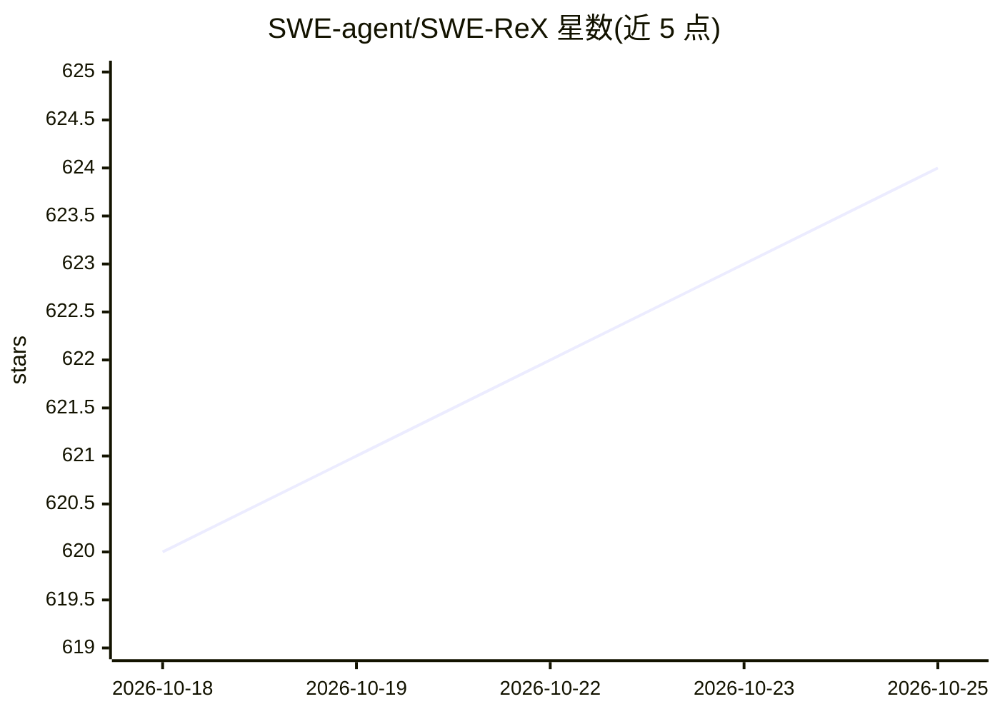

# SWE-agent/SWE-ReX

⭐ 624 · Python · MIT · 推送 2026-10-19 · [GitHub](https://github.com/SWE-agent/SWE-ReX) · [官网](https://swe-rex.com/) · 组织维护

**给 AI agent 开发者的沙箱化远程命令执行运行时框架**

SWE-agent 团队推出的运行时接口库：让 AI agent 在本地 shell、Docker 容器、AWS 远程机器或 Modal 等沙箱环境中执行任意命令，agent 代码无需随执行环境改变。支持识别命令结束并提取输出与退出码、使用 ipython/gdb 等交互式工具、以及大规模并行运行多个 shell 会话。定位为将 agent 逻辑与基础设施解耦，服务 SWE-agent 等项目的开发与基准评测。以 pip 包形式安装，提供 modal 扩展安装选项。

## 筛选速览

| 维度 | 判定 | 备注 |
|---|---|---|
| AI 角色 | `ai-ecosystem` | LLM/agent 周边工具 |
| 许可风险 | `permissive` | MIT |
| 部署形态 | `library` | 以包/库形式分发 |
| 模型依赖 | — | README 未给出锁定关系 |
| 硬件要求 | — | 无带数字的原话,不猜 |
| 安装摩擦 | `low` | 无编译、无系统依赖或容器化 |
| 成熟度 | — | 结构信号不足 |

## 能力要点

- 在本地/Docker/AWS/Modal 等环境统一执行命令，agent 代码保持不变
- 交互式 shell 会话（ipython、gdb）与多会话并行
- 支持大规模并行 agent 运行，用于大型基准评测
- 将 agent 逻辑与基础设施解耦

## 适用场景

- 让编码 agent 在沙箱中安全执行任意 shell 命令
- 并行运行上百个 agent 做大规模基准评测
- 在不同执行平台间切换而无需改动 agent 代码

## 场景标签

`Agent 框架` · 领域:Agent 开发

## 证据(README 行号)

> L9: SWE-ReX is a runtime interface for interacting with sandboxed shell environments, allowing you to effortlessly let y
> L20: We built SWE-ReX to help you focus on developing and evaluating your agent, not on infrastructure.

## 星数曲线

2026-10-18 620 → 2026-10-25 624（+4）

---
*卡片 v1 · prompt 1.4 · 生成 2026-10-21 · 置信度 high · 依据 README sha `897b98410b05` · [字段定义](../../DATASET.md)*
