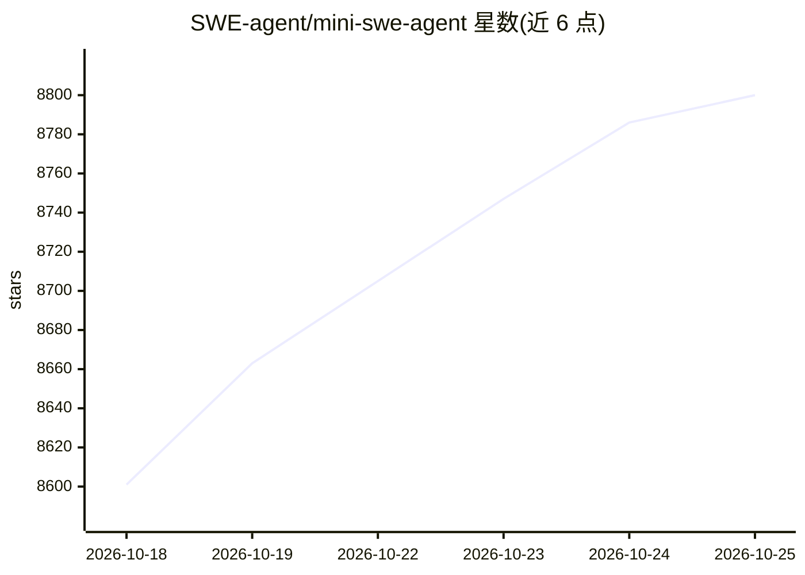

# SWE-agent/mini-swe-agent

⭐ 8,800 · Python · MIT · 推送 2026-10-19 · [GitHub](https://github.com/SWE-agent/mini-swe-agent) · [官网](https://mini-swe-agent.com) · 组织维护

**约百行代码的极简 AI 编程 agent，解 GitHub issue、辅助命令行**

由 SWE-agent/SWE-bench 团队（Princeton & Stanford）构建的极简软件工程 agent：agent 类仅约百行 Python，唯一工具是 bash，不依赖 LLM 工具调用接口，动作经 subprocess.run 独立执行，消息历史完全线性，便于调试与微调。支持本地环境、docker/podman、singularity/apptainer 等沙箱，模型接入经 litellm/openrouter/portkey。提供 CLI（mini）、Python 绑定、批推理与轨迹浏览器；SWE-bench verified 得分 >74%。当前为 v2，v1 迁移需读迁移指南。

## 筛选速览

| 维度 | 判定 | 备注 |
|---|---|---|
| AI 角色 | `ai-ecosystem` | LLM/agent 周边工具 |
| 许可风险 | `permissive` | MIT |
| 部署形态 | `library` | 以包/库形式分发 |
| 模型依赖 | locked-api |  |
| 硬件要求 | — | 无带数字的原话,不猜 |
| 安装摩擦 | `low` | 无编译、无系统依赖或容器化 |
| 成熟度 | — | 结构信号不足 |

## 能力要点

- agent 类约百行 Python，唯一工具为 bash，无需工具调用接口
- 动作以 subprocess.run 独立执行，历史完全线性，适合调试与微调
- 支持本地环境、docker/podman、singularity/apptainer 等多种沙箱
- SWE-bench verified 得分 >74%，提供 CLI、Python 绑定与轨迹浏览器

## 适用场景

- 在命令行让 AI 解决 GitHub issue 或编写代码任务
- 作为 agent 研究的 baseline 系统（FT/RL 训练）
- 在沙箱中批量运行 benchmark 评测

## 场景标签

`编码 Agent` `Agent 框架` · 领域:Agent 开发

## 证据(README 行号)

> L24: - **Minimal**: Just some 100 lines of python for the agent class (and a bit more for the environment,
> L38: - **Does not have any tools other than bash** — it doesn't even need to use the tool-calling interface of the LMs.

## 星数曲线

2026-10-18 8,601 → 2026-10-25 8,800（+199）

---
*卡片 v1 · prompt 1.4 · 生成 2026-10-20 · 置信度 high · 依据 README sha `85404b7ca558` · [字段定义](../../DATASET.md)*
