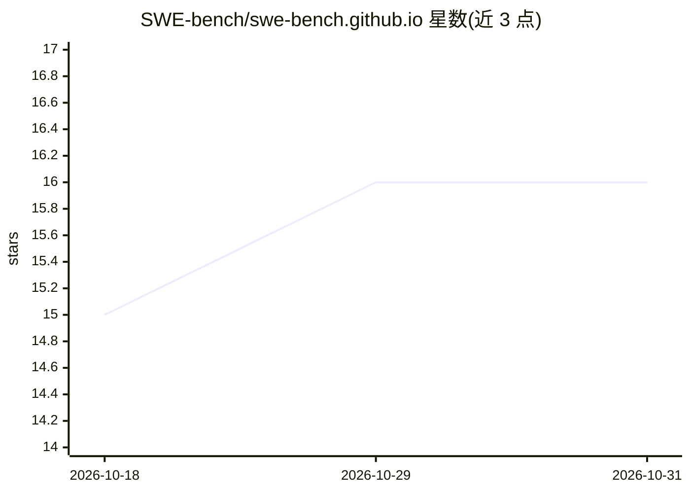

# SWE-bench/swe-bench.github.io

⭐ 16 · JavaScript · NOASSERTION · 推送 2026-09-01 · [GitHub](https://github.com/SWE-bench/swe-bench.github.io) · [官网](https://www.swebench.com/) · 组织维护

**SWE-bench 基准榜单官网：展示自动解决 GitHub issue 的评测排行**

SWE-bench 基准的官方网站代码库，展示各系统在自动解决 GitHub issue 任务上的排行榜与项目信息。构建链路为：build.py 读取 data/leaderboards.json 数据，用 Jinja2 模板渲染静态 HTML，输出 dist/ 目录，可托管于 GitHub Pages 或任意静态主机。榜单含 Test/Lite/Verified/Multimodal 等分区，前端用 Vanilla JavaScript 提供排序、筛选与切换，模板为奖牌、New、开源、Verified 等条目添加徽标。开发流程基于 uv 与 Make 命令（install/build/serve）。

## 筛选速览

| 维度 | 判定 | 备注 |
|---|---|---|
| AI 角色 | `ai-knowledge` | 知识聚合/清单类 |
| 许可风险 | `none` | NOASSERTION |
| 部署形态 | `None` |  |
| 模型依赖 | — | README 未给出锁定关系 |
| 硬件要求 | — | 无带数字的原话,不猜 |
| 安装摩擦 | `medium` | 含编译或系统依赖之一 |
| 成熟度 | — | 结构信号不足 |

## 能力要点

- build.py + Jinja2 + leaderboards.json 的静态站点生成流程
- 多分区榜单（Test/Lite/Verified/Multimodal）统一数据驱动
- JavaScript 提供榜单排序、筛选与标签切换
- GitHub Pages 自动部署（deploy.yml）

## 适用场景

- 查阅 SWE-bench 各系统解决 GitHub issue 的评测排名
- 修改 leaderboards.json 后重新构建更新榜单数据
- 基于该模板搭建其他基准的榜单站点

## 场景标签

`模型评测` · 领域:评测与运维

## 证据(README 行号)

> L13: This is the codebase for the SWE-bench website, which showcases leaderboards for the SWE-bench benchmark. SWE-bench
> L100: 1. **Data Source**: All leaderboard data is stored in `data/leaderboards.json`. This JSON file contains an array o

## 星数曲线

2026-10-18 15 → 2026-10-31 16（+1）

---
*卡片 v1 · prompt 1.4 · 生成 2026-10-30 · 置信度 high · 依据 README sha `335895909324` · [字段定义](../../DATASET.md)*
