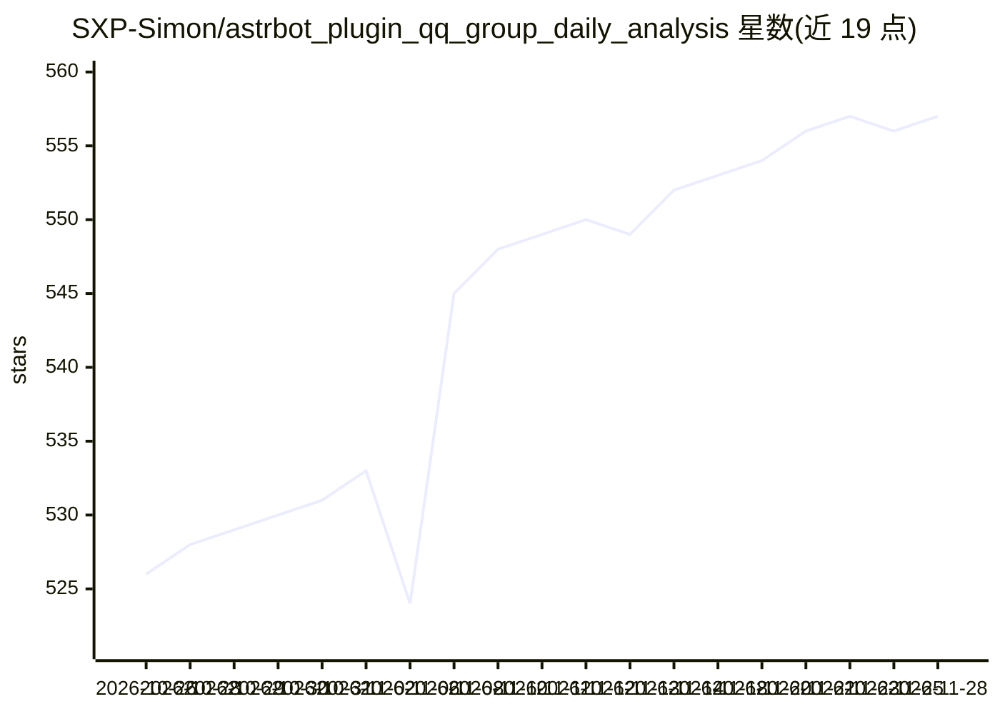

# SXP-Simon/astrbot_plugin_qq_group_daily_analysis

⭐ 557 · Python · MIT · 推送 2026-11-20 · [GitHub](https://github.com/SXP-Simon/astrbot_plugin_qq_group_daily_analysis) · 个人维护 · 中文 README

**AstrBot 群聊分析插件：LLM 总结群聊并生成报告海报与连环漫画**

作为 AstrBot 宿主的插件运行，自动定时或手动分析群聊消息，用 LLM 提取话题、金句、用户画像并生成图片/HTML 报告，还可将分析结果改编为 14 种内置风格的连环漫画。支持 QQ 官方机器人、Telegram、Discord、OneBot v11、Satori 平台；内嵌 WebUI 管理面板，提供任务可观测、历史报告重绘、Token 消耗看板、模型熔断与多级回退机制。分析依赖宿主配置的 LLM Provider，漫画生图需自行配置服务商 API Key。

## 筛选速览

| 维度 | 判定 | 备注 |
|---|---|---|
| AI 角色 | `ai-native` | 本体是模型或模型工具 |
| 许可风险 | `permissive` | MIT |
| 部署形态 | `None` |  |
| 模型依赖 | locked-api |  |
| 硬件要求 | — | 无带数字的原话,不猜 |
| 安装摩擦 | `low` | 无编译、无系统依赖或容器化 |
| 成熟度 | — | 结构信号不足 |

## 能力要点

- 定时/手动/增量三种分析模式与黑白名单继承判定
- 漫画分镜支持 14 种内置风格及自定义提示词，多绘图供应商条目按优先级切换
- WebUI 提供运行链路、熔断状态、Token 消耗与数据审计
- LLM 原生函数调用工具，支持自然语言只读检索历史报告

## 适用场景

- 群主想在群里自动产出每日聊天总结与活跃度报告
- 给机器人社区生成趣味群聊连环漫画活跃气氛
- 管理员想查看分析的 Token 消耗与运行日志做运维

## 场景标签

`聊天机器人` `AI 写作` `图像生成` `LLM 可观测性` · 领域:对话与助手

## 证据(README 行号)

> L16: _✨ 一个基于 AstrBot 的智能群聊分析插件，支持 **QQ 官方机器人**、**Telegram**、**Discord**、**OneBot v11**、**Satori**，未来支持更多平台。 ✨_
> L72: - **话题分析**: 使用LLM智能提取群聊中的热门话题和讨论要点
> L170: 5. 可选切换绘图后端 `drawing_backend`：`builtin`（默认，使用本插件内置绘图客户端）；`general_plugin`（调用 「通用生图」插件 公共 API）；`big_banana`（调用 「大香蕉

## 星数曲线

2026-10-26 526 → 2026-11-28 557（+31）

---
*卡片 v1 · prompt 1.4 · 生成 2026-11-25 · 置信度 high · 依据 README sha `50b554bbf81b` · [字段定义](../../DATASET.md)*
