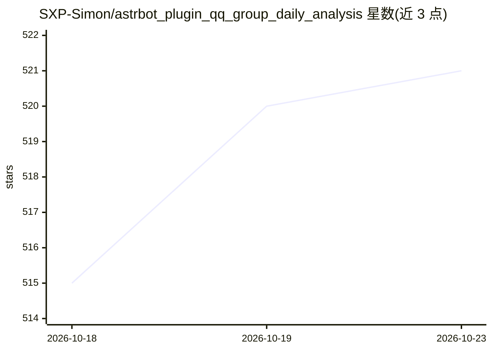

# SXP-Simon/astrbot_plugin_qq_group_daily_analysis

⭐ 521 · Python · MIT · 推送 2026-10-22 · [GitHub](https://github.com/SXP-Simon/astrbot_plugin_qq_group_daily_analysis) · 个人维护 · 中文 README

**AstrBot 群聊分析插件：LLM 总结群聊并生成报告海报与漫画**

基于 AstrBot 的群聊分析插件，支持 OneBot（NapCat/LLOneBot/SnowLuma 等）、QQ 官方机器人、Telegram、Discord 多平台。读取群消息后用 LLM 提取热门话题、用户画像、金句等，生成可视化图片/HTML 报告，并可将分析结果改编为连环漫画（支持图生图参考图与多家绘图服务商预设）。自带 WebUI 管理面板，提供运行总览、历史报告、消耗统计、日志与配置中心；原生接入 AstrBot LLM Tool Calling，可在自然语言对话中只读检索报告或按需触发分析。

## 筛选速览

| 维度 | 判定 | 备注 |
|---|---|---|
| AI 角色 | `ai-native` | 本体是模型或模型工具 |
| 许可风险 | `permissive` | MIT |
| 部署形态 | `None` |  |
| 模型依赖 | — | README 未给出锁定关系 |
| 硬件要求 | — | 无带数字的原话,不猜 |
| 安装摩擦 | `low` | 无编译、无系统依赖或容器化 |
| 成熟度 | — | 结构信号不足 |

## 能力要点

- LLM 提取话题、用户画像、金句并生成图片/HTML 可视化报告
- 每日群漫画：支持参考图与多家绘图服务商预设（Gemini/OpenAI/xAI/豆包/DashScope 等）
- 内嵌 WebUI：运行总览、历史报告、Token 消耗看板、日志与可视化配置
- 原生 LLM 工具：只读报告检索（0 额外 Token）与管理员鉴权的异步分析触发

## 适用场景

- 定时或手动总结群聊讨论内容并生成海报/网页报告
- 把群聊话题自动改编成趣味连环漫画
- 通过自然语言向机器人查询某天群里聊了什么

## 场景标签

`数据分析` `图像生成` · 领域:效率与自动化

## 证据(README 行号)

> L16: _✨ 一个基于 AstrBot 的智能群聊分析插件，支持 **OneBot** ( NapNeko/NapCatQQ , LLOneBot/LuckyLilliaBot , SnowLuma/SnowLuma )、**QQ 官方机
> L55: - **话题分析**: 使用LLM智能提取群聊中的热门话题和讨论要点
> L309: 插件原生接入 AstrBot `@filter.llm_tool` 规范，为宿主大模型（Agent）注入群聊分析记忆与调度能力。用户无需记忆任何 `/` 斜杠指令，在日常自然语言对话中即可与 AI 助手无缝交互：

## 星数曲线

2026-10-18 515 → 2026-10-23 521（+6）

---
*卡片 v1 · prompt 1.4 · 生成 2026-10-22 · 置信度 high · 依据 README sha `4d983f2329f2` · [字段定义](../../DATASET.md)*
