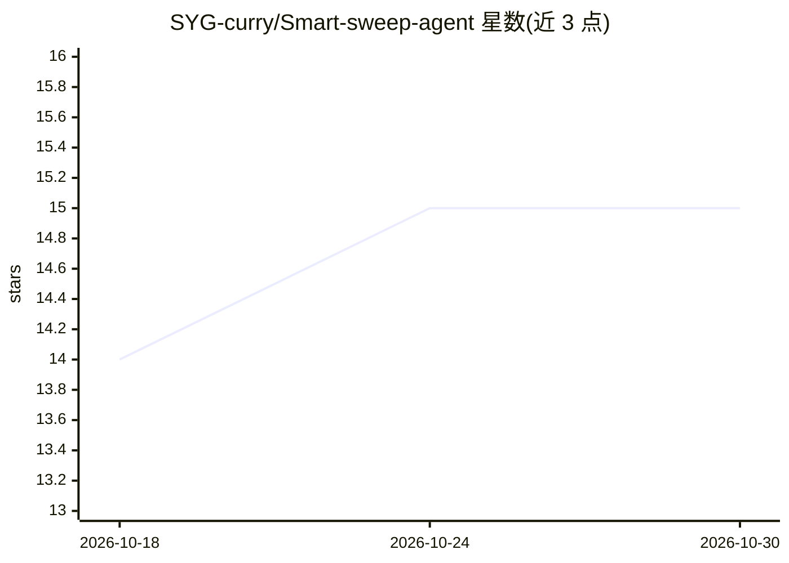

# SYG-curry/Smart-sweep-agent

⭐ 15 · Python · MIT · 推送 2026-06-19 · [GitHub](https://github.com/SYG-curry/Smart-sweep-agent) · 个人维护 · 中文 README

**扫地机器人领域的 RAG 智能客服 Agent 前后端应用**

基于 LangChain + FastAPI + Vue 3 构建的扫地机器人领域智能客服：ReAct Agent 调用知识库检索、天气、用户信息、报告生成等工具；RAG 使用 Chroma 向量检索 + Reranker 重排（Top-K 召回后精排 Top-N）；提供 JWT 认证、多用户会话隔离、SSE 流式输出（thinking/answer 分区）、Redis 缓存与限流（不可用时自动降级）、MySQL/SQLite 持久化与日志入库。LLM 使用通义千问（qwen3-max）与 DashScope Embeddings，需自备 API Key。README 自述适用于初学者自学 RAG 和 Agent 项目，从 Streamlit Demo 演进而来，开发阶段未引入 Alembic，Docker Compose 在后续计划中。

## 筛选速览

| 维度 | 判定 | 备注 |
|---|---|---|
| AI 角色 | `ai-native` | 本体是模型或模型工具 |
| 许可风险 | `permissive` | MIT |
| 部署形态 | `self-host` | docker 或自建部署 |
| 模型依赖 | — | README 未给出锁定关系 |
| 硬件要求 | — | 无带数字的原话,不猜 |
| 安装摩擦 | `low` | 无编译、无系统依赖或容器化 |
| 成熟度 | `idea` | |

## 能力要点

- ReAct Agent 支持知识库检索、天气、用户信息、报告生成等工具调用
- Chroma 向量检索 + Reranker 重排的 RAG 流程
- JWT 认证 + 多用户会话隔离 + SSE 流式输出
- Redis 缓存/限流可自动降级，日志异步写入 MySQL

## 适用场景

- 初学者学习 RAG 与 Agent 前后端完整项目结构
- 搭建领域知识库问答的多用户客服系统
- 参考 FastAPI + Vue 3 + SSE 流式聊天的实现

## 场景标签

`文档问答` `聊天机器人` · 领域:对话与助手

## 证据(README 行号)

> L3: 基于 **LangChain + FastAPI + Vue 3** 构建的扫地机器人领域智能客服 Agent。支持 RAG 知识库问答、多轮对话、用户认证与会话隔离、SSE 流式输出、Redis 缓存/限流以及 MySQL 日志持
> L20: |**ReAct Agent**|基于 LangChain，支持知识库检索、天气、用户信息、外部数据、报告生成等工具调用|
> L48: - **LLM / Agent**：LangChain · LangGraph · 通义千问（qwen3-max）

## 星数曲线

2026-10-18 14 → 2026-10-30 15（+1）

---
*卡片 v1 · prompt 1.4 · 生成 2026-10-30 · 置信度 mid · 依据 README sha `fc0ffc2d1263` · [字段定义](../../DATASET.md)*
