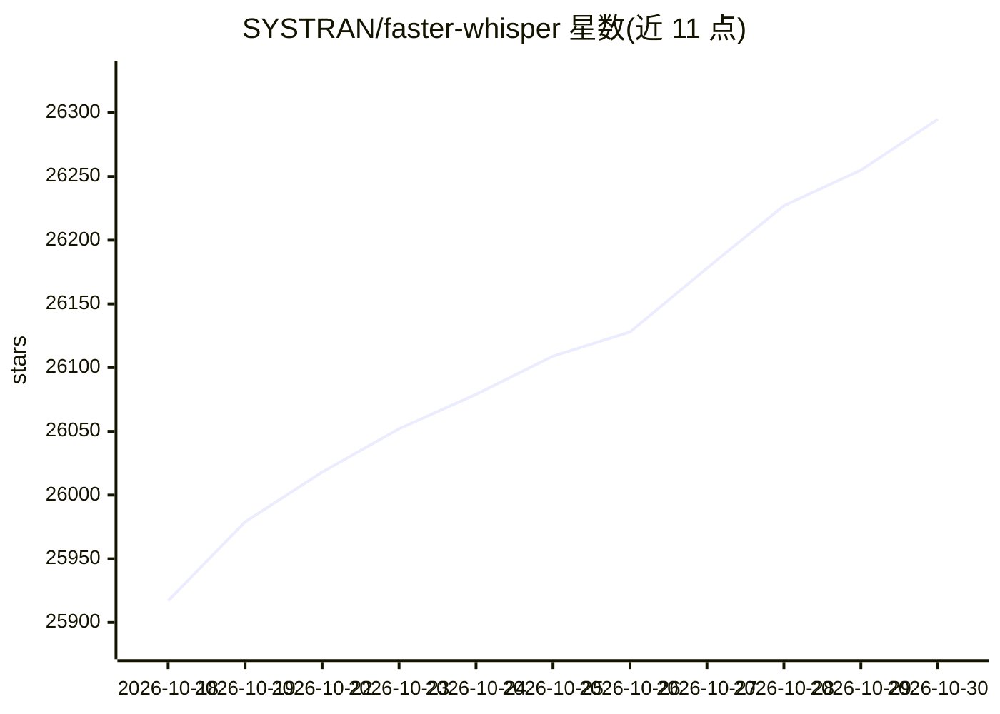

# SYSTRAN/faster-whisper

⭐ 26,295 · Python · MIT · 推送 2026-10-25 · [GitHub](https://github.com/SYSTRAN/faster-whisper) · 组织维护

**基于 CTranslate2 的 Whisper 语音转写推理库**

使用 CTranslate2 推理引擎重新实现的 OpenAI Whisper 语音转写库，提供 Python API 加载模型并对音频文件转写。支持 CPU 与 GPU 运行，支持 int8/fp16 量化与批量转写管线，内置 Silero VAD 过滤无语音片段，可输出词级时间戳。模型可按尺寸从 Hugging Face Hub 自动下载，也可用脚本将 Transformers 兼容的 Whisper 模型转换为 CTranslate2 格式。经 PyPI 安装，GPU 运行需另行安装 cuBLAS 与 cuDNN 9。

## 筛选速览

| 维度 | 判定 | 备注 |
|---|---|---|
| AI 角色 | `ai-native` | 本体是模型或模型工具 |
| 许可风险 | `permissive` | MIT |
| 部署形态 | `library` | 以包/库形式分发 |
| 模型依赖 | — | README 未给出锁定关系 |
| 硬件要求 | — | 无带数字的原话,不猜 |
| 安装摩擦 | `medium` | 含编译或系统依赖之一 |
| 成熟度 | — | 结构信号不足 |

## 动量与使用信号

- 维护:`active` — 距上次 push 1.9 天,年发版 1,51 位贡献者
- 涨星:近 1 天 **+30**(自 20261016 起算)
- 安装:pypi 包 `faster-whisper` 月下载 9,614,222
- 平台:WINDOWS / LINUX · 协议:OPENAI-API

## 能力要点

- 基于 CTranslate2 的 Whisper 推理，支持 int8/fp16 量化
- BatchedInferencePipeline 批量转写，接口与单条转写兼容
- 集成 Silero VAD 过滤静音段，支持词级时间戳
- 提供模型转换脚本，可加载微调后的 Whisper 模型

## 适用场景

- 把音频文件批量转写为带时间戳的文字
- 在 CPU 或 GPU 上本地运行 Whisper 语音识别
- 将自定义微调的 Whisper 模型转为 CTranslate2 格式部署

## 场景标签

`语音识别` `推理引擎` `模型量化` · 领域:感知与多模态

## 证据(README 行号)

> L5: **faster-whisper** is a reimplementation of OpenAI's Whisper model using CTranslate2, which is a fast inference engi
> L7: This implementation is up to 4 times faster than openai/whisper for the same accuracy while using less memory. The e

## 星数曲线

2026-10-18 25,917 → 2026-10-30 26,295（+378）

---
*卡片 v1 · prompt 1.4 · 生成 2026-10-18 · 置信度 high · 依据 README sha `768ac87ec835` · [字段定义](../../DATASET.md)*
