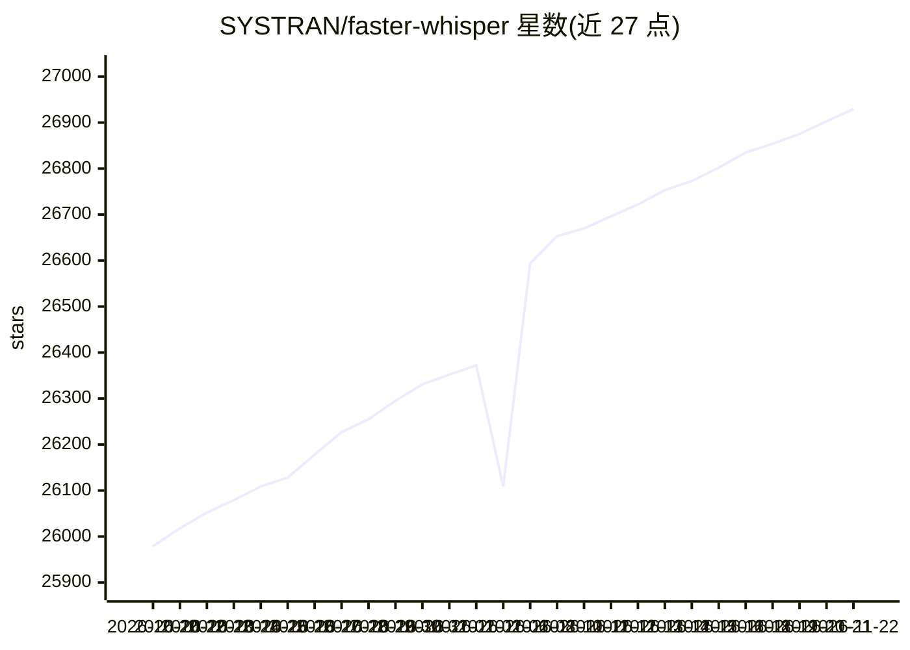

# SYSTRAN/faster-whisper

⭐ 26,929 · Python · MIT · 推送 2026-11-12 · [GitHub](https://github.com/SYSTRAN/faster-whisper) · 组织维护

**Whisper 的 CTranslate2 重实现，语音转文字推理库**

基于 CTranslate2 推理引擎对 OpenAI Whisper 模型的重实现，面向需要本地运行语音识别的开发者。音频经 PyAV 解码（系统无需安装 FFmpeg），支持 CPU 与 GPU 运行、8-bit 量化、批量转录、词级时间戳与 Silero VAD 静音过滤；模型可按尺寸名自动从 Hugging Face Hub 下载，也提供转换脚本处理 Transformers 兼容的 Whisper 模型（含微调模型）。从 PyPI 安装，GPU 路径需另装 cuBLAS 与 cuDNN 9。

## 筛选速览

| 维度 | 判定 | 备注 |
|---|---|---|
| AI 角色 | `ai-native` | 本体是模型或模型工具 |
| 许可风险 | `permissive` | MIT |
| 部署形态 | `library` | 以包/库形式分发 |
| 模型依赖 | — | README 未给出锁定关系 |
| 硬件要求 | — | 无带数字的原话,不猜 |
| 安装摩擦 | `medium` | 含编译或系统依赖之一 |
| 成熟度 | — | 结构信号不足 |

## 动量与使用信号

- 维护:`active` — 距上次 push 1.9 天,年发版 1,51 位贡献者
- 涨星:近 1 天 **+30**(自 20261016 起算)
- 安装:pypi 包 `faster-whisper` 月下载 9,614,222
- 平台:WINDOWS / LINUX · 协议:OPENAI-API

## 能力要点

- CPU/GPU 均可运行，支持 8-bit 量化降低内存占用
- 批量转录接口 BatchedInferencePipeline 可替换单条 transcribe
- 词级时间戳与 Silero VAD 语音段过滤
- 提供 ct2-transformers-converter 脚本转换任意 Transformers 兼容 Whisper 模型

## 适用场景

- 本地批量转录音频文件生成文字稿
- 为已有 Whisper 微调模型做 CTranslate2 格式转换与部署
- 在无需安装系统 FFmpeg 的环境中做语音识别

## 场景标签

`语音识别` `推理引擎` · 领域:感知与多模态

## 证据(README 行号)

> L5: **faster-whisper** is a reimplementation of OpenAI's Whisper model using CTranslate2, which is a fast inference engi
> L57: * Python 3.9 or greater
> L59: Unlike openai-whisper, FFmpeg does **not** need to be installed on the system. The audio is decoded with the Python

## 星数曲线

2026-10-20 25,979 → 2026-11-22 26,929（+950）

---
*卡片 v1 · prompt 1.4 · 生成 2026-11-22 · 置信度 high · 依据 README sha `3bdcd281a142` · [字段定义](../../DATASET.md)*
