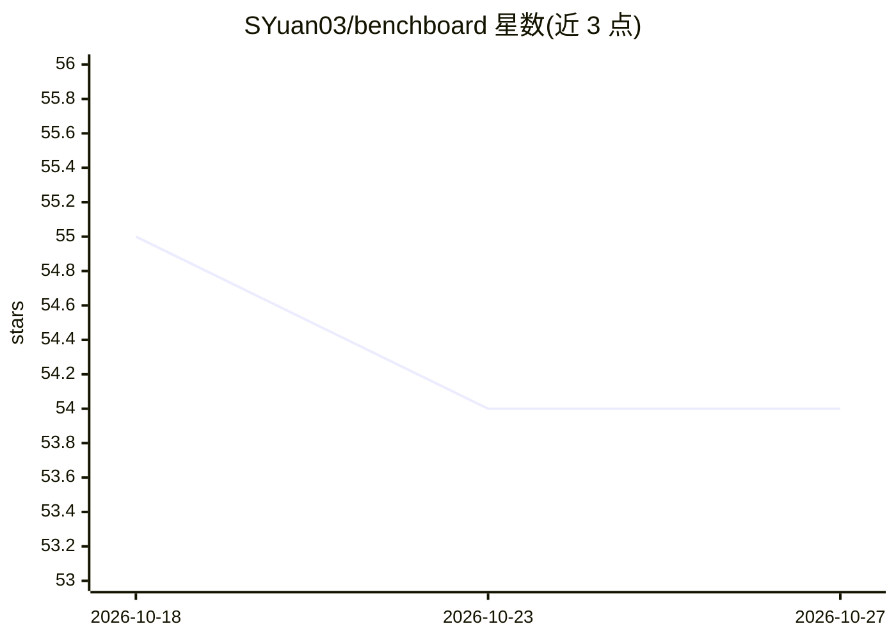

# SYuan03/benchboard

⭐ 54 · JavaScript · MIT · 推送 2026-10-24 · [GitHub](https://github.com/SYuan03/benchboard) · [官网](https://syuan03.github.io/benchboard/) · 个人维护

**AI 模型公开基准成绩的来源链接型索引站点**

收录已发表的 AI 模型基准测试结果：203 个模型版本、585 个基准族、9,584 条公开结果、319 个一手来源。每条分数保留模型版本、基准变体、评测设置（推理力度、harness、任务数、快照日期等）与原始出处，不同 harness 或版本的 result 分开存放，不生成跨基准合成分。站点提供检索、最多三个版本对比、CSV 导出与来源覆盖矩阵，并记录来源审计状态与冲突值。以网页排行榜形式提供，另有多模态输入专题集合。

## 筛选速览

| 维度 | 判定 | 备注 |
|---|---|---|
| AI 角色 | `ai-knowledge` | 知识聚合/清单类 |
| 许可风险 | `permissive` | MIT |
| 部署形态 | `desktop` | 安装包/桌面程序 |
| 模型依赖 | — | README 未给出锁定关系 |
| 硬件要求 | — | 无带数字的原话,不猜 |
| 安装摩擦 | `low` | 无编译、无系统依赖或容器化 |
| 成熟度 | — | 结构信号不足 |

## 能力要点

- 9,584 条公开结果均保留原始来源链接与评测设置
- 拒绝跨基准合成分，冲突的一手值分列存放
- 来源覆盖矩阵记录每个来源的审计完成状态
- 支持最多三个模型版本对比与 CSV 导出

## 适用场景

- 查某个模型发布在各基准上的官方成绩及其出处
- 对比不同模型版本在同一基准下的表现
- 审计基准数据来源的完整性与冲突情况

## 场景标签

`模型评测` · 领域:评测与运维

## 证据(README 行号)

> L7: BenchBoard indexes published benchmark results for current AI models. Every score keeps its model release, benchmark
> L9:  203 models and versions, 585 benchmark families, 9,584 public results, 319 primary sources
> L146: BenchBoard is an evidence index. It does not claim independent reproduction or recommend one model from a single s

## 星数曲线

2026-10-18 55 → 2026-10-27 54（-1）

---
*卡片 v1 · prompt 1.4 · 生成 2026-10-24 · 置信度 high · 依据 README sha `5c9811f9e03b` · [字段定义](../../DATASET.md)*
