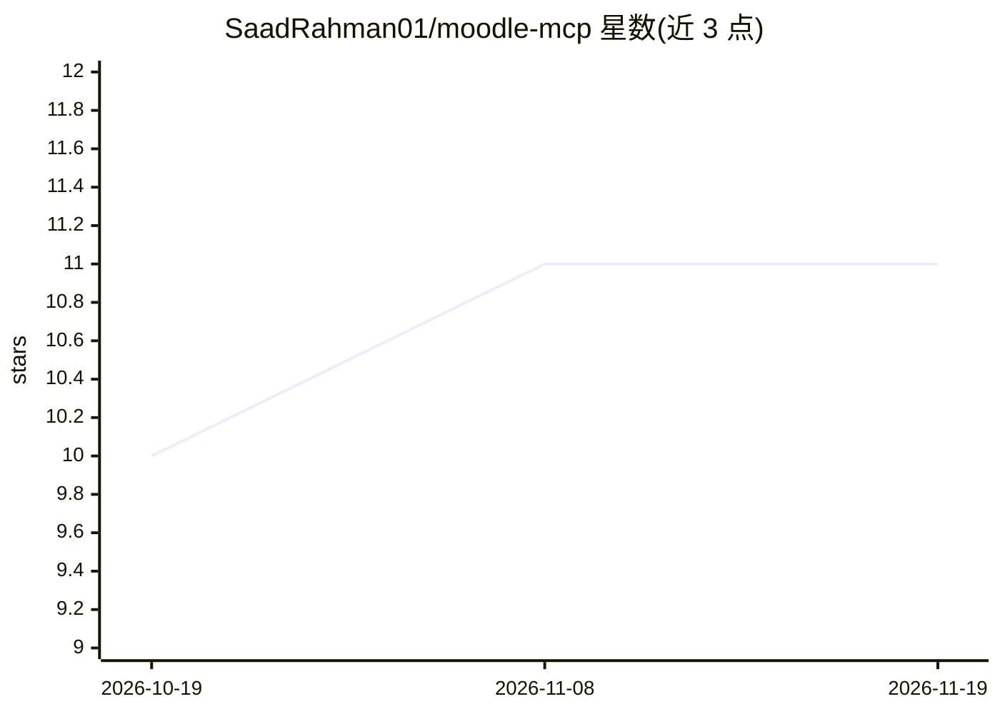

# SaadRahman01/moodle-mcp

⭐ 11 · Python · MIT · 推送 2026-06-06 · [GitHub](https://github.com/SaadRahman01/moodle-mcp) · 个人维护

**给 AI 助手提供 Moodle 开发文档实时检索的 MCP 服务器**

一个 Model Context Protocol 服务器，面向 Moodle 插件开发者，让接入的 AI 助手实时查询 moodledev.io 文档、Hooks API、能力（capabilities）、XMLDB 数据库模式以及 Moodle Jira tracker。提供 10 个 MCP 工具（文档搜索、页面抓取、tracker 检索、Web Services 调用等）、资源、提示模板与工具注解；文档检索基于公开 sitemap 的本地缓存与 BM25/三元组重排，无需 API key，可选配置 Algolia 提升检索精度；文档工具之外，配置 MOODLE_URL 与 MOODLE_TOKEN 后可对真实 Moodle 实例调用 Web Services。

## 筛选速览

| 维度 | 判定 | 备注 |
|---|---|---|
| AI 角色 | `ai-ecosystem` | LLM/agent 周边工具 |
| 许可风险 | `permissive` | MIT |
| 部署形态 | `self-host` | docker 或自建部署 |
| 模型依赖 | locked-api |  |
| 硬件要求 | — | 无带数字的原话,不猜 |
| 安装摩擦 | `low` | 无编译、无系统依赖或容器化 |
| 成熟度 | — | 结构信号不足 |

## 能力要点

- 10 个 MCP 工具覆盖文档搜索、Hooks API、XMLDB、版本信息与 Jira tracker 检索
- 基于公开 sitemap 的磁盘缓存检索，文档查询无需 API key
- 支持 MCP resources、prompts、工具注解与进度通知
- 提供 Claude Desktop/Cursor/Continue/Cline 等客户端的接入配置说明

## 适用场景

- 在编辑器里让 AI 助手查询 Moodle 开发文档与 API 用法
- 让 AI 助手搜索 tracker.moodle.org 上的 issue 并按版本过滤
- 通过 WS token 让 AI 助手调用真实 Moodle 实例的 Web Services 函数

## 场景标签

`语义搜索` · 领域:知识与检索

## 证据(README 行号)

> L3: > Model Context Protocol server for Moodle development. Plug into Claude Desktop, Cursor, Continue, Cline, or any MC
> L9: Companion to `claude-moodle-dev` — that plugin teaches AI assistants the Moodle conventions; this server gives them 
> L13: Ten MCP tools, hardened to survive site redesigns:

## 星数曲线

2026-10-19 10 → 2026-11-19 11（+1）

---
*卡片 v1 · prompt 1.4 · 生成 2026-11-18 · 置信度 high · 依据 README sha `4d9378ac7fea` · [字段定义](../../DATASET.md)*
