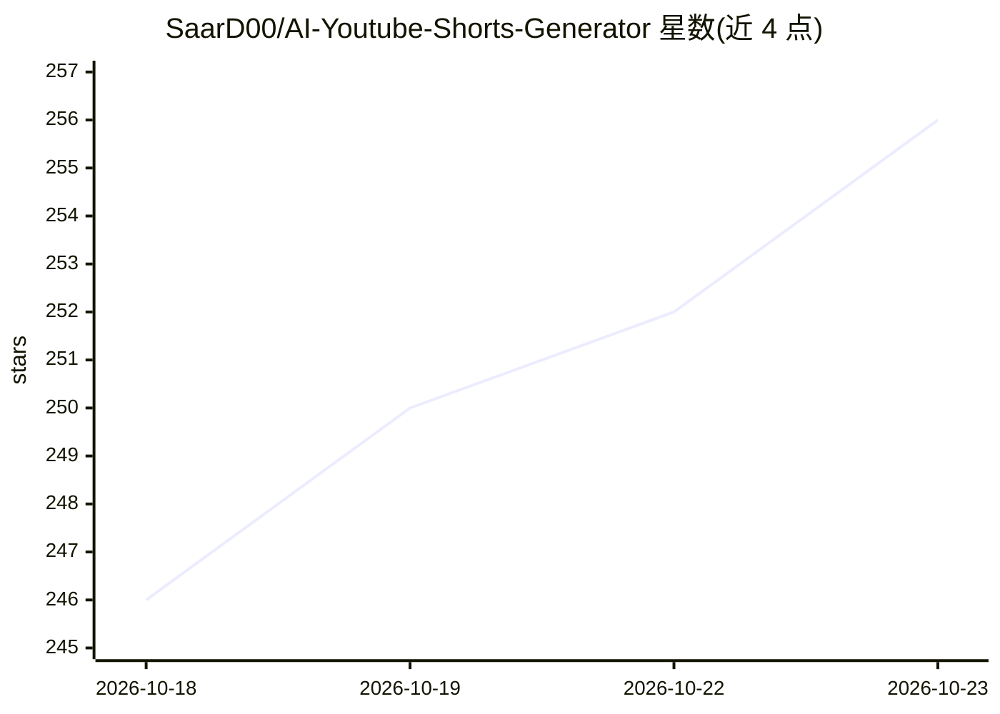

# SaarD00/AI-Youtube-Shorts-Generator

⭐ 256 · Python · MIT · 推送 2026-10-13 · [GitHub](https://github.com/SaarD00/AI-Youtube-Shorts-Generator) · 个人维护

**自动生成“无人出镜”短视频的 Python 流水线**

AutoShorts AI 是一条端到端视频生产流水线：用 Google Gemini 生成热门主题与 8-9 场景脚本，edge-tts 生成旁白 MP3，从 Pexels 下载 9:16 竖版素材，再用 FFmpeg 完成 A/B 画面切换、xfade 转场、静音剪除、头像注入并导出 H.264 MP4。支持非交互批量运行（cron/CI）、手机友好的 Flask Web 界面、Docker 部署与 OAuth 自动上传 YouTube（默认 private，受每日配额约 6 次限制）。需要 Gemini 与 Pexels API key、Python 3.10+ 和 FFmpeg。

## 筛选速览

| 维度 | 判定 | 备注 |
|---|---|---|
| AI 角色 | `ai-native` | 本体是模型或模型工具 |
| 许可风险 | `permissive` | MIT |
| 部署形态 | `self-host` | docker 或自建部署 |
| 模型依赖 | — | README 未给出锁定关系 |
| 硬件要求 | — | 无带数字的原话,不猜 |
| 安装摩擦 | `low` | 无编译、无系统依赖或容器化 |
| 成熟度 | — | 结构信号不足 |

## 能力要点

- Gemini 生成脚本 + edge-tts 旁白 + Pexels 素材 + FFmpeg 剪辑的完整链条
- A/B 画面切换、xfade 随机转场、静音剪除与头像注入
- 非交互批量运行，可接入 cron/systemd/CI 与 GitHub Actions
- Flask Web 界面与 Docker Compose 部署，支持自动上传 YouTube

## 适用场景

- 按主题自动批量生产 YouTube Shorts/TikTok 竖版视频
- 用 cron 或 CI 定时每日自动发布短视频
- 通过手机 Web 界面选题并直接下载成品视频

## 场景标签

`视频生成` · 领域:内容生成

## 证据(README 行号)

> L5: **AutoShorts AI** is a Python pipeline that creates viral-style "Faceless" YouTube Shorts and TikToks from a topic. 
> L9: - **🧠 Intelligent Scriptwriting:** Uses **Google Gemini 2.0 Flash** to write engaging, "Edutainment" style scripts (

## 星数曲线

2026-10-18 246 → 2026-10-23 256（+10）

---
*卡片 v1 · prompt 1.4 · 生成 2026-10-22 · 置信度 high · 依据 README sha `35294f4d09cc` · [字段定义](../../DATASET.md)*
