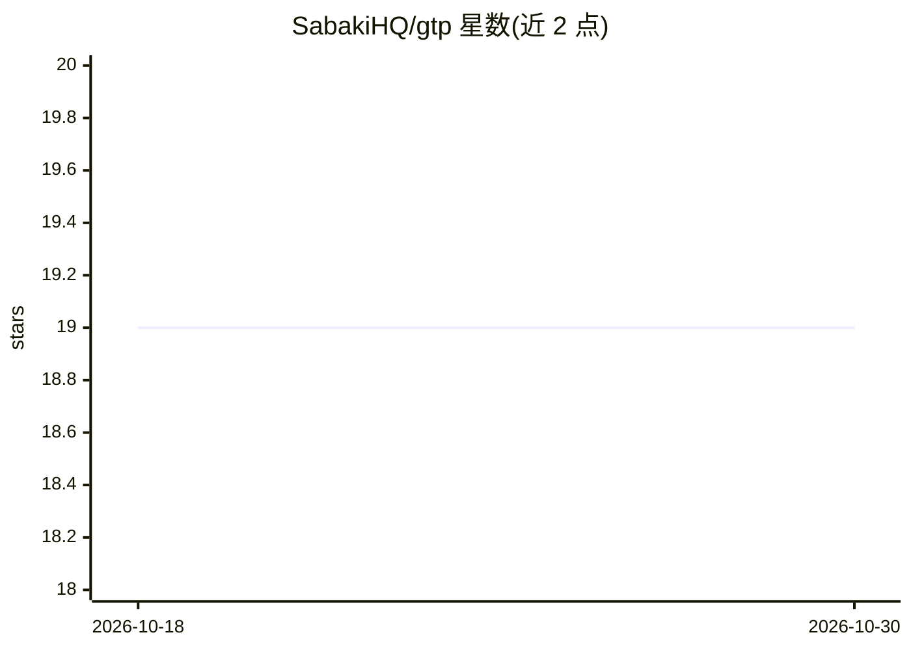

# SabakiHQ/gtp

⭐ 19 · JavaScript · MIT · 推送 2026-08-13 · [GitHub](https://github.com/SabakiHQ/gtp) · 组织维护

**Node.js 库：通过 GTP 协议控制与实现围棋引擎**

提供 Go Text Protocol (GTP) 的命令与响应序列化（Command/Response 类）、StreamController 与 Controller 两级控制器（后者可自动 spawn 引擎进程并通过 stdin/stdout 通信，支持命令队列与逐行响应订阅）、ControllerStateTracker 用于跟踪与同步引擎状态（komi/boardsize/history），以及 Engine 类用于在自定义通道上实现 GTP 引擎（内置 protocol_version、name、list_commands 等默认命令）。以 npm 包形式安装，面向围棋软件开发者。

## 筛选速览

| 维度 | 判定 | 备注 |
|---|---|---|
| AI 角色 | `ai-ecosystem` | LLM/agent 周边工具 |
| 许可风险 | `permissive` | MIT |
| 部署形态 | `library` | 以包/库形式分发 |
| 模型依赖 | — | README 未给出锁定关系 |
| 硬件要求 | — | 无带数字的原话,不猜 |
| 安装摩擦 | `low` | 无编译、无系统依赖或容器化 |
| 成熟度 | — | 结构信号不足 |

## 能力要点

- Command/Response 对象与 GTP 字符串的双向转换
- Controller 可 spawn 引擎进程并经 stdin/stdout 控制，带命令队列与事件
- ControllerStateTracker 跟踪并同步引擎状态
- Engine 类支持自定义通道实现 GTP 引擎

## 适用场景

- 在围棋 GUI（如 Sabaki）中接入和管理 GTP 引擎进程
- 编写自定义 GTP 引擎并挂接到任意通信通道
- 跟踪/同步引擎的贴目、棋盘尺寸与对局历史状态

## 场景标签

 · 领域:棋类/协议库

## 证据(README 行号)

> L3: A Node.js module for handling GTP engines.
> L162: Use this class to spawn GTP engine processes and control them over `stdin` and

## 星数曲线

2026-10-18 19 → 2026-10-30 19（+0）

---
*卡片 v1 · prompt 1.4 · 生成 2026-10-28 · 置信度 high · 依据 README sha `460d80d6cc56` · [字段定义](../../DATASET.md)*
