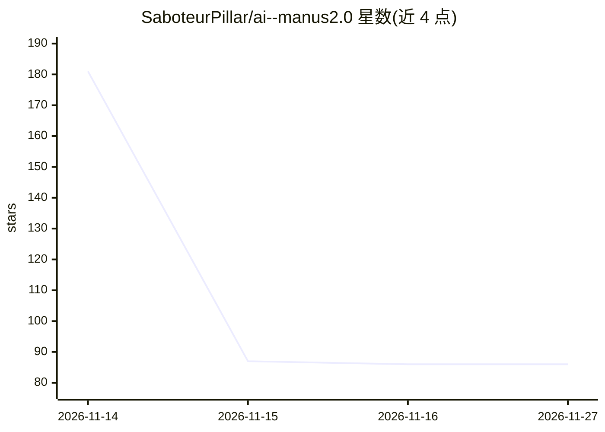

# SaboteurPillar/ai--manus2.0

⭐ 86 · Apache-2.0 · 推送 2026-11-15 · [GitHub](https://github.com/SaboteurPillar/ai--manus2.0) · 个人维护

**自主 AI Agent：代用户执行代码并控制浏览器完成多步任务**

Manus 是面向个人日常任务的自主 AI Agent：用户以自然语言下达指令，Agent 规划步骤，自主编写并执行脚本、控制浏览器导航网页与填写表单，可跨脚本与浏览器衔接完成多步任务，并在会话间复用已学工作流。定位为家用、学习与轻量办公场景的助手，而非企业平台。README 给出系统兼容性表（最低双核 CPU / 4 GB 内存，推荐多核 / 8 GB）与使用步骤，但未给出具体安装命令、模型接入方式或源码结构，实现细节不可验证。

## 筛选速览

| 维度 | 判定 | 备注 |
|---|---|---|
| AI 角色 | `ai-native` | 本体是模型或模型工具 |
| 许可风险 | `permissive` | Apache-2.0 |
| 部署形态 | `None` |  |
| 模型依赖 | — | README 未给出锁定关系 |
| 硬件要求 | — | 无带数字的原话,不猜 |
| 安装摩擦 | `low` | 无编译、无系统依赖或容器化 |
| 成熟度 | — | 结构信号不足 |

## 能力要点

- 自主编写并执行代码完成任务的 Agent
- 浏览器控制：导航、填表、采集信息
- 脚本与浏览器动作可在同一任务流中衔接
- 面向家庭、学习与轻量办公的小规模场景

## 适用场景

- 让 Agent 代我查网页、填表单、收集资料
- 把重复的小脚本与浏览器操作交给 Agent 处理
- 学习与研究中整理笔记、跑快速计算

## 场景标签

`浏览器自动化` `编码 Agent` `AI 助手` · 领域:效率与自动化

## 证据(README 行号)

> L10: - **Autonomous Code Execution:** Manus AI agent runs code on its own to complete tasks, so you can focus on decisio
> L18: Manus is an autonomous AI agent designed to run code and control a browser on your behalf. Instead of acting like a
> L22: Manus is not a heavy studio suite or a complex enterprise platform. It is a focused helper built for home, study, a

## 星数曲线

2026-11-14 181 → 2026-11-27 86（-95）

---
*卡片 v1 · prompt 1.4 · 生成 2026-11-17 · 置信度 mid · 依据 README sha `637da4fbcded` · [字段定义](../../DATASET.md)*
