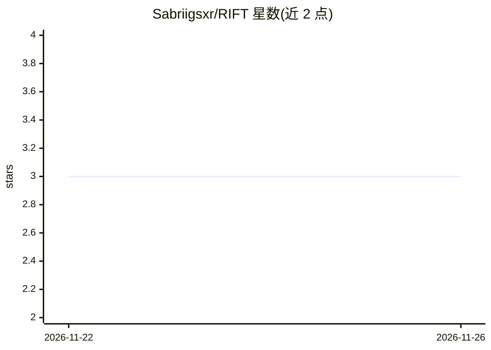

# Sabriigsxr/RIFT

⭐ 3 · Python · 推送 2026-11-16 · [GitHub](https://github.com/Sabriigsxr/RIFT) · 个人维护

**面向授权攻防研究的本地 MCP 语义检索引擎**

RIFT 将本地攻防安全问答知识库封装为可检查的 MCP 工具：输入问题后用 Sentence Transformers + FAISS 做语义检索，返回条目的 doc_id、分数、元数据、问题与答案，并提供抽取式回答与索引统计。捆绑索引含 23,737 条对齐条目，模型缓存后检索无需网络。仅提供检索能力，不执行命令或自主利用；HTTP 传输无内置认证，需保持在 loopback。

## 筛选速览

| 维度 | 判定 | 备注 |
|---|---|---|
| AI 角色 | `ai-native` | 本体是模型或模型工具 |
| 许可风险 | `none` | — |
| 部署形态 | `library` | 以包/库形式分发 |
| 模型依赖 | — | README 未给出锁定关系 |
| 硬件要求 | — | 无带数字的原话,不猜 |
| 安装摩擦 | `low` | 无编译、无系统依赖或容器化 |
| 成熟度 | — | 结构信号不足 |

## 能力要点

- MCP server 暴露 4 个能力：语义搜索、抽取式回答、索引统计、简报模板
- 本地 Sentence Transformers + FAISS 检索，模型缓存后离线可用
- 捆绑 23,737 条对齐问答条目的本地索引
- 支持 stdio 传输与 localhost 可选 HTTP 传输

## 适用场景

- 授权渗透测试前检索检测与 DFIR 相关知识
- 检测工程中查阅攻防场景条目及元数据
- 安全教学中的可视化学习路径与检索示例

## 场景标签

`RAG` `语义搜索` `向量数据库` `网络安全` · 领域:知识与检索

## 证据(README 行号)

> L5: **MCP-powered retrieval for authorized offensive-security intelligence.**
> L23: **Implemented:** semantic search with Sentence Transformers + FAISS,
> L34: The bundled index contains 23,737 aligned entries. Query-time retrieval uses

## 星数曲线

2026-11-22 3 → 2026-11-26 3（+0）

---
*卡片 v1 · prompt 1.4 · 生成 2026-11-22 · 置信度 high · 依据 README sha `f7f32c5929b8` · [字段定义](../../DATASET.md)*
