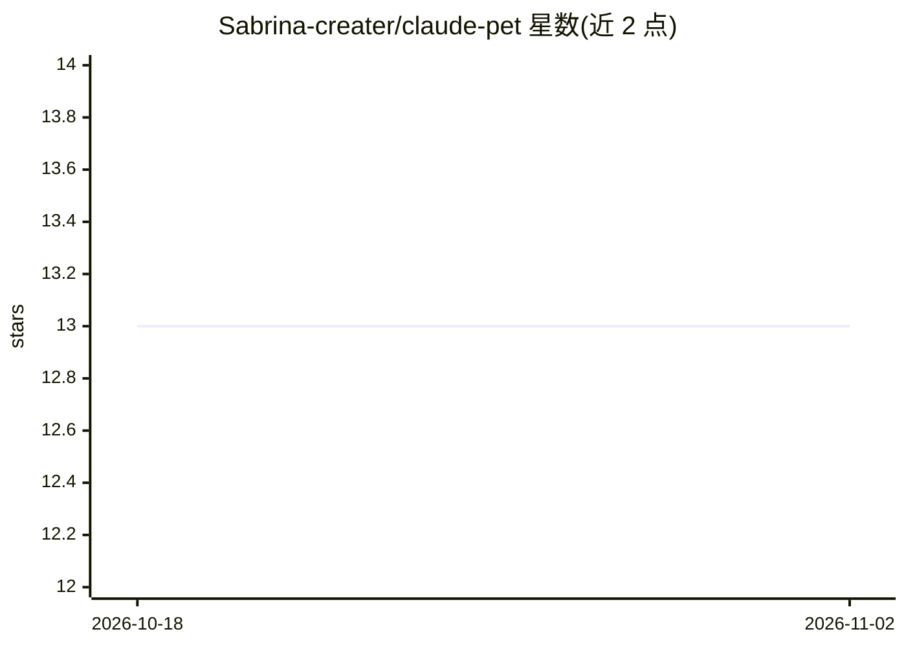

# Sabrina-creater/claude-pet

⭐ 13 · JavaScript · MIT · 推送 2026-09-15 · [GitHub](https://github.com/Sabrina-creater/claude-pet) · 个人维护 · 中文 README

**macOS 桌宠：宠物照片离线抠图生成桌宠并联动 Claude Code**

基于 PySide6 + QML + three.js（QtWebEngine）的 macOS 桌面宠物：内置 21 种 3D 形象，支持上传 .glb 模型；通过 macOS 系统 Vision 框架做全离线 AI 抠图，把用户宠物照片/视频转成透明动画贴到六个活动槽（待机/走路/吃饭等）。含养成玩法（喂食/摸摸/遛弯、经验升级），并只读扫描 ~/.claude 与 ~/.codex 本地文件，统一显示 Claude Code/Codex 会话状态，AI 干活时宠物有反应；v1.5.2 提供额度恢复后自动唤醒的实验功能。要求 macOS 14+（抠图），发布包为 Apple 芯片 arm64，Intel Mac 需自行构建。

## 筛选速览

| 维度 | 判定 | 备注 |
|---|---|---|
| AI 角色 | `ai-enhanced` | 去掉 AI 部分产品仍成立 |
| 许可风险 | `permissive` | MIT |
| 部署形态 | `desktop` | 安装包/桌面程序 |
| 模型依赖 | — | README 未给出锁定关系 |
| 硬件要求 | — | 无带数字的原话,不猜 |
| 安装摩擦 | `low` | 无编译、无系统依赖或容器化 |
| 成熟度 | `idea` | |

## 能力要点

- 本地 Vision 框架离线抠图，照片/视频转透明动画宠物（六个活动槽）
- 只读扫描 ~/.claude / ~/.codex，统一显示 Claude Code 与 Codex 会话状态并跳转原会话
- 支持上传 .glb/.gltf 自定义 3D 形象，自动归一化
- 额度恢复后自动唤醒的实验功能（v1.5.2，默认关闭）

## 适用场景

- 把自家宠物的照片/视频变成桌面上会动、可喂养的桌宠
- 写代码时通过桌宠一眼看到 Claude Code / Codex 会话的运行状态
- 会话额度恢复后自动续跑等待中的消息

## 场景标签

`图像视频处理` · 领域:感知与多模态

## 证据(README 行号)

> L7: > A macOS desktop pet that lives above all your windows — feed it, walk it, turn your own
> L8: > pet's photos/videos into its skin via fully-offline AI matting (Apple Vision framework),
> L9: > and watch it react to your Claude Code and Codex sessions. PySide6 + QML + three.js in QtWebEngine.
> L13: > 本项目为社区作品,与 Anthropic 无关联;宠物本体功能不依赖 Claude、完全离线。

## 星数曲线

2026-10-18 13 → 2026-11-02 13（+0）

---
*卡片 v1 · prompt 1.4 · 生成 2026-10-31 · 置信度 mid · 依据 README sha `0425910dc10d` · [字段定义](../../DATASET.md)*
