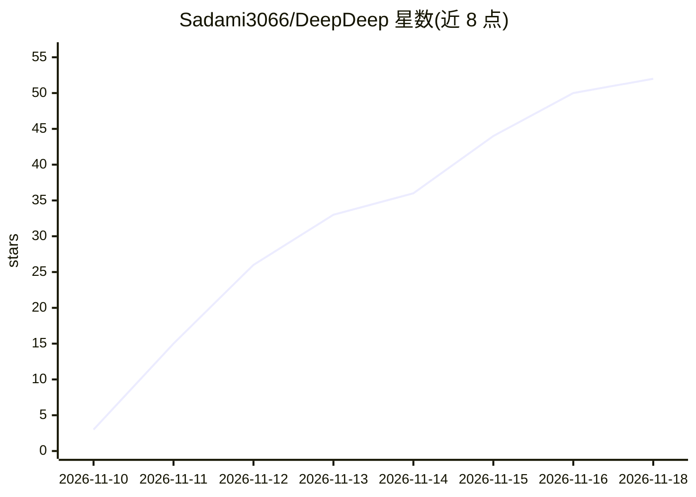

# Sadami3066/DeepDeep

⭐ 52 · Kotlin · Apache-2.0 · 推送 2026-11-16 · [GitHub](https://github.com/Sadami3066/DeepDeep) · 个人维护 · 中文 README

**Android 手机端运行的个人 AI Agent 应用**

用 Kotlin/Jetpack Compose 编写的 Android 个人智能体应用：长按电源唤醒、语音与文字交互，内置工具、技能、长期记忆、MCP 扩展与插件系统的 Agent 运行时；通过 proot 运行超轻量 Alpine Linux 环境执行办公与代码任务，可经无线调试或 Root 操作其他 App 与手机文件，并支持小程序、统一扫码与远程连接电脑。模型接入需用户自行配置 42 家服务商的 API Key 或 OAuth，对话内容仅发送给模型厂商，无数据收集上传。APK 从 GitHub Releases 分发，要求 Android 10+；文档明确 proot 非安全沙箱、插件与 App 同进程无沙箱等边界。

## 筛选速览

| 维度 | 判定 | 备注 |
|---|---|---|
| AI 角色 | `ai-native` | 本体是模型或模型工具 |
| 许可风险 | `permissive` | Apache-2.0 |
| 部署形态 | `None` |  |
| 模型依赖 | locked-api |  |
| 硬件要求 | — | 无带数字的原话,不猜 |
| 安装摩擦 | `medium` | 含编译或系统依赖之一 |
| 成熟度 | — | 结构信号不足 |

## 能力要点

- 手机端本地运行 Agent：工具、技能、长期记忆、MCP 与插件系统
- proot 运行 Alpine Linux，覆盖办公与代码任务并安装 Node/Python 工具链
- 三档系统访问（普通/无线调试 ADB/Root）可操作手机文件与虚拟屏幕操控 App
- 支持 42 家模型服务商，API Key 或浏览器 OAuth 接入

## 适用场景

- 在手机上通过语音或文字让 Agent 代办任务、盯票、整理文件
- 在手机端 Linux 环境里编写和运行代码
- 通过 MCP 插件连接飞书、Notion、邮件等外部服务处理远程任务

## 场景标签

`AI 助手` `编码 Agent` `GUI 自动化` · 领域:效率与自动化

## 证据(README 行号)

> L19: DeepDeep：你的个人智能体，在手机端运行
> L27: 同时配备完整的 Harness 工程，包含工具、技能、长期记忆、MCP 扩展和插件系统。它便捷地运行在手机上，无需服务器，无需电脑常开，随时随地都可以打开使用，只要你长按电源，一句话，它就能开始工作，把事情办好。

## 星数曲线

2026-11-10 3 → 2026-11-18 52（+49）

---
*卡片 v1 · prompt 1.4 · 生成 2026-11-18 · 置信度 high · 依据 README sha `33c4ed1386ee` · [字段定义](../../DATASET.md)*
